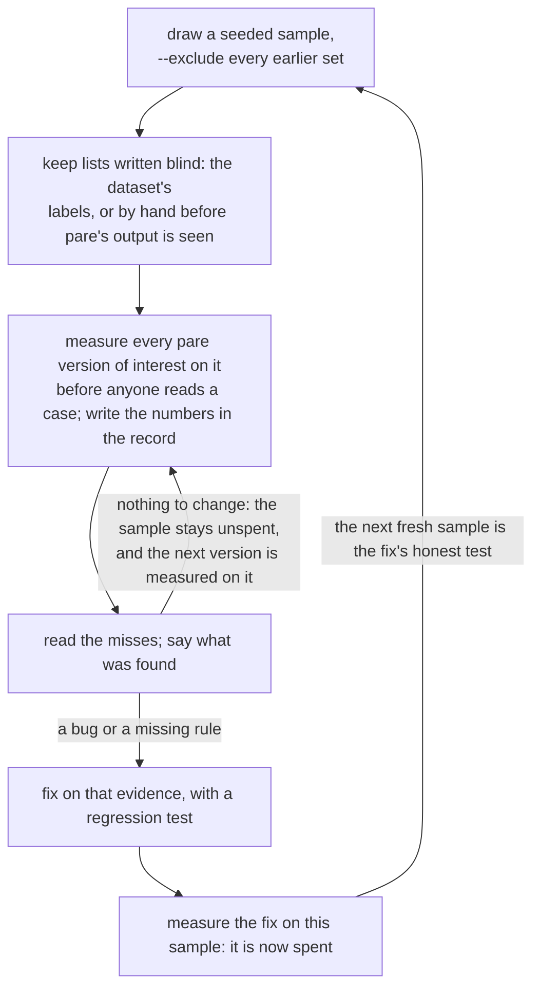

# Held-out corpus

Logs pare was not tuned on, with keep lists written by someone or
something other than pare, so that recall here is a measurement rather
than a training score. The directory holds thirteen sets so far, 214
cases from two datasets: SWE-bench Verified tasks (Python test runs,
labelled by the tests the fix makes pass) and Defects4J bugs (Java
builds, labelled by the trigger tests and their exceptions). No set yet
holds logs from real agent sessions; that is the gap, and the first
section says how to fill it.

Every number in this record before 29 October 2026 is at 2.8 bytes per
token, the default then; the default is 2.0 since (`docs/DESIGN.md`,
"Tokens and the budget"), and the README's table carries the latest two
samples at that rate. Of the two agent-success runs below, the first
used 2.8 and the second 2.0.

One rule governs the directory: a sample is measured before anyone reads
it, and once a change to pare has been judged on it, it is spent and the
next fresh sample measures that change. The record below says, for each
sample, what it found and what spent it.

## Protocol

1. **Collect real logs from actual agent sessions.** The easy way: have
   the agent run its noisy commands as `pare -- CMD` (by instruction or
   with the hook in `integrations/`); each run leaves a raw run file and a
   record of the command. Then `python bench/collect.py list` shows recent
   runs and `python bench/collect.py add N` copies one here with its
   `.cmd`, an empty `.keep` and a `MANIFEST.tsv` line (pare version and
   commit at collection). It replaces your home and working directories
   with `/home/dev` and `/home/dev/proj` and points at credential-shaped
   lines; nothing else is changed. Without pare in the loop, save the raw
   output of the command the agent ran (`cmd > name.log 2>&1`, or the
   tool-result text from the session transcript), untouched: no trimming,
   no scrubbing beyond secrets and paths. Prefer tools the dev corpus
   does not cover: Maven, Gradle, Terraform, kubectl, Bazel, Next.js
   build, tsc, eslint, docker compose, pip install -v, GitHub Actions
   runs. Aim for 15 to 20 files.
2. **Write `name.keep` before running pare on the log.** One line per
   must-survive line: the lines a person fixing the problem would need (the
   error messages, the failing test names, the location, the final
   verdict). Copy them verbatim from the log; a keep line counts when
   its stripped text appears whole in the output, not run on into a
   longer name, and `a || b` lists forms that each count. Record
   `name.cmd` with the command.
   `python bench/collect.py check` confirms every case has a command and a
   keep list whose lines are in its log.
3. **Do not look at pare's output while writing the keep list.** If a keep
   line turns out to be unreasonable after the fact, note it in this file
   rather than editing the list.
4. **Run and report separately:**

   ```
   .venv/bin/python bench/run.py --corpus corpus/heldout --budget 2000
   .venv/bin/python bench/run.py --corpus corpus/heldout --budget 600 --show-misses
   ```

   Report these numbers next to the dev-corpus numbers, never merged with
   them.
5. **Do not tune on this corpus.** If a held-out miss reveals a bug (a false
   positive in severity detection, a segmentation error), fix it with a
   regression test and note that the held-out set has now influenced the
   code; after enough such fixes, collect a fresh held-out set.

**For dataset samples**, as practised twelve times: draw a seeded sample
with `--exclude` on every earlier directory (so no task repeats), run
every pare version of interest on it before reading any case, write the
numbers here, then read the misses and say what was found. A change made
from those misses is measured on the sample, which marks it spent; the
next fresh sample, drawn after the change, is its honest test. The
directory numbers run ahead of the seeds (`swebench-2/` is seed 1,
`swebench-6/` seed 5; `defects4j/` is seed 0 and seed 1 is the dev
sample in `corpus/defects4j-dev/`); each section's command line shows the mapping.

The loop, with the one exit that spends a sample:



## Sources

### Harvesting from existing transcripts

You probably have candidate logs already. Claude Code keeps every session
under `~/.claude/projects/`, including the full text of outputs too large
for the model's context.

```
python bench/harvest.py scan --redact <your-github-handle>   # candidates -> corpus/heldout/inbox/
# for each candidate: read NAME.log, write NAME.keep (NAME.keep.proposed is a draft)
python bench/harvest.py promote NAME [NAME ...]
python bench/collect.py check
```

`inbox/` is ignored by git: it holds scrubbed but unreviewed text from
your sessions. The scrub replaces home paths, email addresses, your login
name and git identity, `--redact` words and credential-shaped strings, and
prints the words it redacts; it cannot know a colleague's name in a commit
message, a customer's data in a log, or an internal host name, so read
each log before promoting it. The proposed keep lines come only from what
the agent did next (lines it quoted, locations and files it opened, tests
it re-ran), never from pare, so they are blind to pare; they do lean
toward what the agent saw, which for a saved large output was a 2 KB
preview. Promoted cases record `transcript` as their source and whether
the keep list started from the proposals, and results should be reported
by source.

**Where pare's summary fell short.** With the Claude Code hook on (or
`pare -- CMD` in the agent's instructions), many outputs the agent saw
were pare summaries; scan swaps in the raw run file (keep pare's run files
for the week: they last 14 days or 500 MB by default) and also reads what
the agent did next. It ranks first the candidates where the agent went
past the summary, with a weighted count shown as `!score`:

| signal | weight |
|---|---|
| expanded it: `pare --only T7` (or `--since`, `--until`, `--except`, `--min-severity`) on the run file | 3 |
| read the run file itself (`cat`, `grep`, `tail`, the Read tool) | 3 |
| ran the command again without pare: `npm test 2>&1 \| tail -80` (a bare rerun the hook wraps again does not count) | 2 |
| opened a file the raw output names and the summary does not | 1 |

Their `NAME.json` lists the signals (`summary_signals`), and
`NAME.summary` keeps the summary the agent saw, to read beside
`NAME.log`. These are the failure modes the datasets cannot show: a
summary that dropped what a real task needed. A high score is a lead,
not a verdict (an agent may read a run file out of habit); the keep list
still comes from the raw log.

### SWE-bench cases

`bench/swebench_cases.py` produces held-out cases with labels nobody
wrote: each SWE-bench task records which tests fail at its buggy commit
(FAIL_TO_PASS), and the harness reruns them in the task's published
Docker image.

```
pip install 'swebench>=5'             # the dataset loader and log parser
python bench/swebench_cases.py run --sample 20 --dry-run   # which tasks, which images
python bench/swebench_cases.py run --sample 20             # writes corpus/heldout/swebench/
python bench/run.py --corpus corpus/heldout/swebench --budget 2000 --show-misses
```

The sample is seeded and spread across repositories, among tasks with at
most 10 failing tests. For each task: pull the image (1 to 4 GB), run the
task's eval script without the fix, confirm with SWE-bench's log parser
that the FAIL_TO_PASS tests failed, and write the case: the test command's
output, the command, and a keep list of the failing test ids as they
appear in the output. A task whose tests did not fail, whose eval did not
run cleanly, or whose output is under 40 lines (pare passes those through
unchanged) is skipped and reported; full logs of failed runs go to
the set's `_failed/`, which git ignores. Images this run pulled are removed
afterwards unless `--keep-images`. `--dataset` takes a local
`.jsonl`/`.json`/`.parquet` with SWE-bench's fields when Hugging Face is out
of reach. Hugging Face serves the dataset's files from other hosts
(`us.aws.cdn.hf.co`, `cas-server.xethub.hf.co`), so a network allowlist
needs those as well as `huggingface.co`.

These are a different kind of keep list from the transcript cases: they
only ask whether the summary names every failing test, not whether it
keeps the assertion or the location. Report them as their own source.

### Defects4J cases

`bench/defects4j_cases.py` does the same for Java. Defects4J records, per
bug, the commit that fixed it, a patch that reverts only the fix, and the
tests that fail on the buggy version with the exception each raises. The
harness rebuilds the buggy version from the upstream project on GitHub
(Defects4J's own installation and download server are not needed), runs
the failing test classes with the project's Maven build in a JDK 8
container, and labels the case with those tests and exceptions as the
output shows them (the assertion message alone when JUnit 4 prints it
under another exception class than Defects4J recorded).

```
python3 bench/defects4j_cases.py run --sample 20 --dry-run
python3 bench/defects4j_cases.py run --sample 20        # writes corpus/heldout/defects4j/
python3 bench/run.py --corpus corpus/heldout/defects4j --budget 600 --show-misses
```

Maven projects only (14 of Defects4J's 17); Ant projects (Closure, Chart)
and Mockito (Gradle) are not covered. A bug whose build fails before any
test runs, whose revision has no Maven build, or whose snapshot parent
POM is no longer published is skipped and reported.

### Capture notes

Running the harnesses inside a container whose outbound TLS is re-signed
by a gateway, or behind Docker Hub's anonymous-pull limit, needs these
workarounds; none changes what a test prints.

- **A TLS-re-signing gateway.** Eval scripts that `pip install` fail to
  verify PyPI inside the container. Mount the gateway's CA bundle and
  point pip at it:
  `--docker-arg=--volume=/path/ca-bundle.crt:/pare-ca.crt:ro --docker-arg=--env=PIP_CERT=/pare-ca.crt`.
- **Docker Hub's rate limit** (`429 Too Many Requests` on pull). Pull the
  image from Google's mirror and tag it with its Docker Hub name; the
  harness uses an image that is already there (and then leaves it for you
  to remove): `docker pull mirror.gcr.io/swebench/sweb.eval.x86_64.<id>:latest`
  and `docker tag` it as `swebench/sweb.eval.x86_64.<id>:latest`, then rerun
  the task with `--instances`.

- **Maven behind the same gateway** fails with `PKIX path building
  failed`. Build a truststore from the image's `cacerts` plus the
  gateway's CA certificates, mount it and pass it in:
  `MAVEN_OPTS="-Djavax.net.ssl.trustStore=/trust/cacerts -Djavax.net.ssl.trustStorePassword=changeit"`
  with `--docker-arg=--volume=DIR:/trust:ro --pass-env MAVEN_OPTS`.
- **Maven's image**: Docker Hub rate-limits anonymous pulls;
  `--image mirror.gcr.io/library/maven:3.9-eclipse-temurin-8` pulls the
  same image from Google's mirror.
- **Colour codes in test ids.** pytest printed `::ESC[1mtest_x ESC[0m`,
  and astropy__astropy-14369 found no id at all until ids were located
  with colour codes removed (a labelling fix, before SWE-bench seed 4).

### Labels

A keep line names one fact the summary should show. When the same fact
can be printed several ways, the line lists the forms separated by
` || ` and counts as kept when any appears:

```
com.google.gson.internal.bind.RecursiveTypesResolveTest.testRecursiveTypeVariablesResolve1 || RecursiveTypesResolveTest.testRecursiveTypeVariablesResolve1
java.lang.StackOverflowError || RecursiveTypesResolveTest.testRecursiveTypeVariablesResolve1 » StackOverflow
```

A form must not run on into a longer name: `…Resolve1` is not shown by
a line naming `…Resolve12` (before this rule, Gson-16 was credited with
one such test at 600). `bench/run.py`, `ablate.py` and `tokens.py` match
this way (`collect.keep_found`); `collect.py check` and `harvest.py
promote` use it to confirm a keep line is in the log.

The forms come from the log and the dataset only, never from pare's
output. The Defects4J harness writes every id form the log contains
(`testX(pkg.Cls)`, `pkg.Cls.testX`, `Cls.testX`; the short form also
matches a stack frame naming the test) and, for an exception, the line
Defects4J recorded, its message alone (12 characters or more), and
Surefire 3's summary form `Cls.testX » Abbrev`. `python3
bench/defects4j_cases.py relabel DIR...` rewrites existing cases from
their logs and recorded triggers, without a build (`--dry-run` shows the
changes). Surefire 3's error summary names a test `pkg.Cls#testX`, so
`pkg.Cls#testX` and `Cls#testX` are id forms too (found on Gson-7, seed
5). The forms came in two steps, each of which moved the Defects4J
numbers; the record below shows both where they happened.

## The record

Thirteen sets, in the order they were drawn. "Blind" is pare as it stood
when the sample was drawn, measured before anyone read a case, at 600 /
1,000 / 2,000 tokens (recall pooled over the set's keep lines, as
`bench/run.py` prints it). "Found" is what reading the misses showed;
"spent by" is the change then measured on the sample, after which its
numbers are training scores. Each sample's section follows, with its
command line, what failed to build, every version's numbers and the
misses as read.

| sample | directory | cases | keep | drawn after | blind | found | spent by |
|---|---|---:|---:|---|---|---|---|
| SWE-bench seed 0 | `swebench/` | 16 | 40 | the prototype | 47.5 / — / 60 % | failing tests collapse into one entry | the failing-test fix (dev data since) |
| Defects4J seed 0 | `defects4j/` | 11 | 31 | the prototype | 29 / — / 94 % | the same, and Maven's closing advice | the failing-test fix (dev data since) |
| SWE-bench seed 1 | `swebench-2/` | 17 | 35 | the failing-test fix | 60 / 60 / 89 % | more failing tests than fit; parametrized names | compact lists; parametrized names |
| Defects4J seed 2 | `defects4j-2/` | 16 | 44 | the failing-test fix | 51 / 74 / 98 % | Maven chatter at 600; one-form labels | the chatter fix; alternative-form labels |
| SWE-bench seed 2 | `swebench-3/` | 16 | 22 | compact lists | 82 / 86 / 95 % | little: most tasks want one test | the chatter fix, measured on it (86 / 91 / 100 %) |
| Defects4J seed 3 | `defects4j-3/` | 18 | 51 | compact lists | 47 / 71 / 94 % | Maven chatter at 600 | the chatter fix (67 / 94 / 98 %) and the window skip |
| Defects4J seed 4 | `defects4j-4/` | 18 | 39 | the window skip | 92 / 100 / 100 % | JUnit 3 assertion messages at 600 | the JUnit 3 rules (100 % at 600) |
| Defects4J seed 5 | `defects4j-5/` | 17 | 46 | the JUnit 3 rules | 87 / 91 / 100 % | messages that differ in one word; the `#` label form | the pair and clip rules, relabelling (93.5 / 97.8 / 100 %) |
| SWE-bench seed 3 | `swebench-4/` | 15 | 17 | the JUnit 3 rules | 94 / 100 / 100 % | one test at 600 | nothing |
| Defects4J seed 6 | `defects4j-6/` | 19 | 40 | structured lines, `auto` | 92.5 / 100 / 100 %, `auto` 100 % | budget squeezes at 600 (Gson-17, Gson-12) | nothing |
| SWE-bench seed 4 | `swebench-5/` | 18 | 30 | 0.2.0 | 90 / 97 / 97 %, `auto` 97 % | pytest's inner runs hide the verdict (pytest-8399) | the tail verdict rule (93 / 100 / 100 %) |
| Defects4J seed 7 | `defects4j-7/` | 16 | 37 | the verdict rule | 92 / 100 / 100 %, `auto` 100 % | one budget squeeze at 600 (Math-66) | nothing |
| SWE-bench seed 5 | `swebench-6/` | 17 | 27 | the verdict rule | 67 / 70 / 100 %, `auto` 100 % | pytest's inner runs crowd out the failures (pytest-7205) | nothing |

Defects4J seed 1 (19 bugs) is the development sample the failing-test fix
was built on, in `corpus/defects4j-dev/`. tidyout, run on the two seed-0
sets, kept everything at 96 to 100 % of the input size; sqz and tidyout
have no budget and were not run on later sets.

### SWE-bench seed 0 and Defects4J seed 0

| source | cases | budget 600 | budget 2,000 |
|---|---:|---|---|
| SWE-bench Verified, seed 0 (`swebench/`) | 16 | 47.5 → 45 % | 60 → 82.5 % (min 0 %) |
| Defects4J, seed 0, one bug per project (`defects4j/`) | 11 | 29 → 48 % (min 25 %) | 94 → 97 % (min 75 %), mostly pass-through |
| dev corpus, for comparison (tuned on) | 8 | 79.5 → 78 % | 100 % |

Before → after the failing-test fix. Both sources missed in the same way:
a run with several failing tests names each in a line of the same shape,
pare listed that shape once with a count, and the tests themselves were
dropped; on Maven at 600, the build's closing `[ERROR]` advice took the
budget as well. The fix was developed on a separate Defects4J sample
(`corpus/defects4j-dev/`), but these sets found the problem and were
checked during the work, so they are no longer held out.

### SWE-bench seed 1 and Defects4J seed 2

Drawn after the failing-test fix, with `--exclude` so no task overlaps a
set that influenced it, and not looked at before measuring:

```
python3 bench/swebench_cases.py run --seed 1 --exclude corpus/heldout/swebench --out corpus/heldout/swebench-2
python3 bench/defects4j_cases.py run --seed 2 --exclude corpus/heldout/defects4j --exclude corpus/defects4j-dev --out corpus/heldout/defects4j-2
```

pare before the fix (commit `d730e86`) → after (`0fc602e`), same cases:

| source | cases | budget 600 | budget 1,000 | budget 2,000 |
|---|---:|---|---|---|
| SWE-bench Verified, seed 1 (`swebench-2/`, 35 keep lines) | 17 | 51 → 60 %, full 12 → 14 | 60 → 60 %, full 14 → 14 | 63 → 89 % (min 33 %), full 14 → 15 |
| Defects4J, seed 2 (`defects4j-2/`, 43 keep lines then, 44 since the `#` form) | 16 | 30 → 51 %, full 2 → 6 | 63 → 74 %, full 6 → 11 | 86 → 98 % (min 88 %), full 13 → 15 |

At 2,000 tokens pare's output is 11 % of the SWE-bench input and 31 % of
the Defects4J input; 10 of the 16 Defects4J logs fit and pass through
untouched, so the Defects4J number that tests the summary is the one at
600 and 1,000. The fix generalises: these numbers are close to, or above,
what the burned sets showed after the fix. One case got worse:
JacksonCore-10 at 1,000, 4 → 3 of 8.

What pare still misses, from reading the misses (no code changed on them):

- **More failing tests than the budget holds.** psf__requests-2317 has 40
  failing tests, many with `assert 503 == 200` (the test server is out of
  the container's reach); the dataset
  wants 8 of them. As lines, 40 names cost about 1,200 tokens: 0 of 8 at
  600 and 1,000, 6 of 8 at 2,000. psf__requests-1724 is the same: 32
  failing, 6 wanted, 2 of 6 at 600 and 1,000, all 6 at 2,000. *Fixed
  since* by the compact list form and rare-failures-first: 8 of 8 at
  2,000, 2 of 8 at 600 and 1,000; the other six fail the way the missing
  network breaks thirty-odd others (`docs/HISTORY.md`, "First change from
  held-out evidence").
- **Test ids that differ only in numbers.** pydata__xarray-6744's
  parametrized `test_rolling_iter[numpy-3-True-1]`, `[numpy-3-True-2]`,
  `[numpy-7-True-1]` mask to one shape, so they are repeats, not a list:
  1 of 3 at every budget. *Fixed since* (bracketed parameters are part of
  a name): 3 of 3 at 1,000 and 2,000; this set is spent for that change.
- **Assertion messages that differ only in numbers.** JacksonCore-10's
  three `AssertionFailedError: expected:<N> but was:<M>` lines mask to one
  shape, so the third is a repeat and does not fit (7 of 8 at 2,000). Its
  message is on screen all the same, in Surefire's summary line
  (`TestSymbolTables.testShortNameCollisionsDirectNew:473 expected:<1024>
  but was:<2048>`), but the keep line asks for the exception line.
- **Maven at 600.** Error- and warning-level build chatter (`[ERROR]
  Errors:`, `See dump files`, `Some problems were encountered while
  building the effective model`) still takes budget, and Gson-16's
  two 1,000-line `StackOverflowError` traces take more. *Fixed since*
  (`docs/HISTORY.md`, "Maven chatter"): this set goes from 51 to 72 % at
  600 and 77 to 93 % at 1,000.
- **Matching is stricter than reading.** Gson-16's keep lines ask for
  `com.google.gson…RecursiveTypesResolveTest.testRecursiveTypeVariablesResolve1`;
  at 1,000 pare shows Maven's summary form
  `RecursiveTypesResolveTest.testRecursiveTypeVariablesResolve1 » StackOverflow`,
  which names the test but does not match, and JacksonCore-10 above is
  the same. Each keep line accepts one form; the numbers count these as
  misses. *Fixed since* (keep lines list alternative forms; see "Labels").

A fix that comes from these diagnoses spends these sets the same way as
the first two, and the next sample (another seed, `--exclude` every
directory above) measures it. Two such changes so far, the
parametrized-name fix and the compact list form, both developed on
synthetic logs and dev sets before being measured here; the next sample
is still what counts.

Since the compact list form, `bench/run.py` expands pare's
`prefix{…}` / `  …item` lists before matching keep lines, so a test named
as a list item counts as kept. `--strict` matches the literal text
instead; it counts every compacted name as missed (SWE-bench seed 1 at
2,000: 100 % expanded, 57 % strict).

### SWE-bench seed 2 and Defects4J seed 3

Drawn after the compact list form and the changes before it, with
`--exclude` every earlier set, and measured before anyone read them.
Three versions of pare on the same cases: before any held-out fix
(`d730e86`), before the Maven chatter fix (`2f13edb`: failing-test
lists, parametrized names, compact lists, rare failures first), and with
it.

```
python3 bench/swebench_cases.py run --seed 2 --exclude corpus/heldout/swebench --exclude corpus/heldout/swebench-2 --out corpus/heldout/swebench-3
python3 bench/defects4j_cases.py run --sample 20 --seed 3 --exclude corpus/heldout/defects4j --exclude corpus/heldout/defects4j-2 --exclude corpus/defects4j-dev --out corpus/heldout/defects4j-3
```

| source | cases | version | 600 | 1,000 | 2,000 |
|---|---:|---|---|---|---|
| SWE-bench Verified, seed 2 (`swebench-3/`, 22 keep lines) | 16 | before any fix | 77 % | 86 % | 95 % |
| | | before the chatter fix | 82 % | 86 % | 95 % |
| | | with it | 86 % | 91 % | 100 % |
| Defects4J, seed 3 (`defects4j-3/`, 51 keep lines) | 18 | before any fix | 33 % | 55 % | 86 % |
| | | before the chatter fix | 47 % | 71 % | 94 % |
| | | with it | **67 %** | **94 %** | 98 % |

swebench-3 was measured with the second version before the chatter fix
was written, and again after; it was never read. It is an easier sample
than the first two (most tasks want one test). Strict matching (no
expansion of compact lists) gives the same numbers on Defects4J and, on
SWE-bench seed 2, 82 / 86 / 100 % with the chatter fix and 77 / 82 / 95 %
before it. tidyout keeps everything at 99.6 % of the input. On
Defects4J seed 3, 9 of 18 logs pass through at 2,000, so 600 and 1,000
are the numbers that test the summary; no case got worse at any budget.
These are old-label numbers; with keep lines that accept each fact's
alternative forms ("Labels"), the last Defects4J row is 76.5 / 98 / 98 %.

**Relabelling with alternative forms**, after seed 3. The change moved
the numbers, so both are recorded here once; the sections above this one
use the old labels, those below the new (pare `3d36efa`, the chatter
fix, in every column; Gson-16 gained a line, its two tests' identical
exceptions being one line each with their own summary forms).

| Defects4J set | budget | old labels | + boundary | + alternatives |
|---|---|---|---|---|
| seed 1 (`corpus/defects4j-dev/`) | 600 / 1,000 / 2,000 | 90.9 / 95.5 / 100 % | same | 90.9 / 100 / 100 % |
| seed 0 (`defects4j/`) | 600 / 1,000 / 2,000 | 64.5 / 93.5 / 100 % | same | 67.7 / 96.8 / 100 % |
| seed 2 (`defects4j-2/`) | 600 / 1,000 / 2,000 | 72.1 / 93.0 / 97.7 % | 69.8 / 93.0 / 97.7 % | 75.0 / 93.2 / 100 % |
| seed 3 (`defects4j-3/`) | 600 / 1,000 / 2,000 | 66.7 / 94.1 / 98.0 % | same | **76.5** / 98.0 / 98.0 % |

The SWE-bench and dev corpora have no alternative forms, and the
boundary rule changes none of their numbers.

### Defects4J seed 4

Defects4J seed 4, drawn after the tail-window change (`b163491`) with
`--exclude` every earlier Defects4J set, and measured before anyone read
it. Seed 3 above is spent: the Maven chatter fix and the tail-window
change were both measured on it.

```
python3 bench/defects4j_cases.py run --sample 20 --seed 4 --exclude corpus/heldout/defects4j --exclude corpus/heldout/defects4j-2 --exclude corpus/heldout/defects4j-3 --exclude corpus/defects4j-dev --out corpus/heldout/defects4j-4
```

18 of 20 bugs gave a case (Collections-3 has no Maven build at that
revision; JacksonXml-5's build failed before any test ran). 39 keep lines,
labelled with alternative forms. Compress-42's exception
(`junit.framework.AssertionFailedError`, no message) never appears in its
log, so only the test is labelled. No log fits in 600 or 1,000 tokens;
13 of 18 fit in 2,000 and pass through.

| version | 600 | 1,000 | 2,000 |
|---|---|---|---|
| before any held-out fix (`d730e86`) | 41 % (min 0) | 79 % (min 0) | 97 % |
| failing-test lists, rare failures first (`2f13edb`) | 59 % (min 0) | 92 % | 97 % |
| + Maven chatter fix (`3d36efa`) | 82 % (min 33) | 97 % | 100 % |
| + head and tail windows skip chatter (`b163491`) | **92 %** (min 67) | **100 %** | 100 % |

Same numbers with `--strict` (no compact lists to expand). Output is 30 %,
50 % and 83 % of the input. Each version kept at least as much as the one
before on every case, except one: Gson-8 at 1,000 went 3 → 2 of 3 with
the chatter fix and back to 3 with the window change. The three misses
left at 600 are all JUnit 3 assertion messages (Codec-2's `EOF
expected:<-1> but was:<13>`, Gson-8's and JxPath-19's `expected:<…> but
was:<…>`); each case's failing test is shown. Nothing was changed for
them when this was measured.

**Spent since.** Those three misses led to two changes (frame names are
not error words; a warning's rarity counts three quarters; `docs/DESIGN.md`,
"JUnit 3 assertion messages"), measured on this sample: 92.3 → 100 % at
600. That number is a training score now; the next honest one needs a
fifth sample.

### Defects4J seed 5

Defects4J seed 5, drawn after the JUnit 3 change (`89e2de8`) with
`--exclude` every earlier Defects4J set, and measured before anyone read
it. It is the first fresh test of that change, whose weights were chosen
on seed 4.

```
python3 bench/defects4j_cases.py run --sample 20 --seed 5 --exclude corpus/heldout/defects4j --exclude corpus/heldout/defects4j-2 --exclude corpus/heldout/defects4j-3 --exclude corpus/heldout/defects4j-4 --exclude corpus/defects4j-dev --out corpus/heldout/defects4j-5
```

17 of 20 bugs gave a case (Collections-1 has no Maven build at that
revision, JacksonXml-5's build failed before any test ran, and Time-22's
compile fix did not apply). 46 keep lines, labelled with alternative
forms. Seven exceptions were left unlabelled because the log never shows
them as Defects4J recorded them: messageless `AssertionFailedError`s
(Jsoup-58, Csv-3) and `ComparisonFailure` messages that JUnit prints in
another form (Cli-12, JxPath-22). No log fits in 600 or 1,000 tokens; 11
of 17 fit in 2,000 and pass through.

| version | 600 | 1,000 | 2,000 |
|---|---|---|---|
| before any held-out fix (`d730e86`) | 45.7 % (min 0) | 67.4 % (min 0) | 95.7 % |
| failing-test lists, rare failures first (`2f13edb`) | 65.2 % | 78.3 % | 100 % |
| + Maven chatter fix (`3d36efa`) | 82.6 % | 89.1 % | 100 % |
| + head and tail windows skip chatter (`821097f`) | 80.4 % | 91.3 % | 100 % |
| + JUnit 3 assertion messages (`89e2de8`) | **87.0 %** (min 33) | **91.3 %** (min 50) | 100 % |

Same numbers with `--strict`. Output is 28 %, 47 % and 77 % of the input.
One case got worse along the way and recovered: Cli-12 at 600 lost a line
to the tail-window change (4 → 3 of 4) and got it back with the JUnit 3
change. That change gained Codec-5, Math-101 and Cli-12 one line each at
600 and changed nothing at 1,000 or 2,000; no case got worse.

What is still missed (from the miss list only; no code changed on it):

- **Gson-7**, 6 keep lines: at 600 two failing tests and their two
  `JsonSyntaxException` messages (`Expected a long but was STRING …`,
  `Expected an int but was STRING …`); at 1,000 one test and the two
  messages. Messages that differ in one word, under one template.
- **Csv-3**: a long `Records do not match expected result (entry 8): …`
  assertion message, at 600 and 1,000.
- **Gson-4**: one of five failing tests at 600.

**Spent since.** Gson-7 led to two changes (a template seen twice lists
both lines; a line is not clipped when the marker saves nothing;
`docs/HISTORY.md`, "Messages that differ in one word") and to the `#`
label form (which also credits Gson-4's missing test). With the new
labels, measured on this sample: 91.3 / 93.5 / 100 % before the changes,
**93.5 / 97.8 / 100 %** after; Gson-7 at 1,000 goes 4 → 6 of 6. That is
a training score now.

**Relabelling with Surefire 3's `#` form.** Surefire 3's error summary names a test
`pkg.Cls#testX` (`[ERROR]   com.google.gson.stream.JsonReaderTest#testPeeking…
IllegalStateException …`), a form the labeller did not list, so a summary
that showed the test only there was scored as missing it. Found on Gson-7
(seed 5). `pkg.Cls#testX` and `Cls#testX` are id forms now; `relabel`
changed 10 cases (Gson and Time, the projects on Surefire 3). With pare
unchanged (`27c905c`), only seed 5 moves: 87.0 → 91.3 % at 600 (Gson-4,
Gson-7), 91.3 → 93.5 % at 1,000 (Gson-7); the sections above use the
old labels.

### SWE-bench seed 3

SWE-bench Verified seed 3, drawn after the JUnit 3 change (`27c905c`) with
`--exclude` every earlier SWE-bench set, on the maintainer's machine (this
repository's cloud environment cannot reach Hugging Face), and measured
before anyone read it. The last fresh SWE-bench sample (seed 2) predates
the Maven chatter fix, the head and tail window change and the JUnit 3
change; none of them is aimed at pytest, so this checks they cost nothing
there.

```
python3 bench/swebench_cases.py run --sample 20 --seed 3 --exclude corpus/heldout/swebench --exclude corpus/heldout/swebench-2 --exclude corpus/heldout/swebench-3 --out corpus/heldout/swebench-4
```

15 tasks gave a case (four more ran but their FAIL_TO_PASS tests did not
fail as recorded, an environment problem; their logs are in `_failed/`).
17 keep lines; most tasks want one failing test. The logs are larger than
Defects4J's (805 to 36,120 tokens, 172,887 in all): one fits in 1,000
tokens, three in 2,000.

| version | 600 | 1,000 | 2,000 |
|---|---|---|---|
| before any held-out fix (`d730e86`) | 76.5 % | 100 % | 100 % |
| failing-test lists, rare failures first (`2f13edb`) | 82.4 % | 100 % | 100 % |
| + Maven chatter fix (`3d36efa`) | 94.1 % | 100 % | 100 % |
| + head and tail windows skip chatter (`821097f`) | 94.1 % | 100 % | 100 % |
| + JUnit 3 assertion messages (`89e2de8`) | **94.1 %** | **100 %** | **100 %** |

Same numbers with `--strict`. Output is 5 %, 8 % and 14 % of the input.
The window and JUnit 3 changes change no case here (the second trims 3
tokens at 600); no case got worse with any version. The chatter fix helps
pytest too (psf__requests-6028, pydata__xarray-4695 at 600): its advice
class covers pytest's and Python's closing hints as well as Maven's. The
one miss is pydata__xarray-4094 at 600, its single failing test
(`test_to_stacked_array_to_unstacked_dataset`), shown at 1,000.

### Defects4J seed 6

Defects4J seed 6, drawn after the structured-log change (`77966f0`, the
0.2.0 code before the verdict rule; with the truststore of the capture
notes above) with `--exclude` every earlier Defects4J set, and measured
before anyone read it. It is the first fresh test of the Gson-7 change
(a template seen twice lists both lines; a line is not clipped when the
marker saves nothing) and of `--budget auto`.

```
python3 bench/defects4j_cases.py run --sample 20 --seed 6 --exclude corpus/heldout/defects4j --exclude corpus/heldout/defects4j-2 --exclude corpus/heldout/defects4j-3 --exclude corpus/heldout/defects4j-4 --exclude corpus/heldout/defects4j-5 --exclude corpus/defects4j-dev --out corpus/heldout/defects4j-6
```

19 of 20 bugs gave a case (Csv-13's build failed before any test ran).
40 keep lines; every trigger test and exception was located in its log.
No log fits in 600 or 1,000 tokens; 12 of 19 fit in 2,000 and pass
through.

| version | 600 | 1,000 | 2,000 | `auto` |
|---|---|---|---|---|
| before any held-out fix (`d730e86`) | 60.0 % (min 0) | 90.0 % (min 33) | 97.5 % (min 67) | — |
| 0.2.0 at `77966f0` (before the verdict rule) | **92.5 %** (min 33) | **100 %** | **100 %** | **100 %** |
| 0.2.0 without the pair rule | 92.5 % | 97.5 % | 100 % | |
| 0.2.0 without the clip rule | 92.5 % | 100 % | 100 % | |

Output is 27 %, 44 % and 72 % of the input at 600, 1,000 and 2,000;
`auto` keeps all 40 lines at 51 % (21,086 tokens against 29,565 at
2,000). `--strict` gives 90 % at 600 and 100 % at 1,000. On data it was
not chosen on, the pair rule earns one line (Gson-17 at 1,000, 2 → 3 of
3); the clip rule changes nothing, either way.

The three misses at 600, read after scoring (no code changed on them):

- **Gson-17**, 2 of 3 lost: seven tests fail, but only three are the
  bug's trigger tests; four are locale tests that fail in the capture
  container (French dates, `1 janv. 1970`). The failing-test list shows
  five, and `testUnexpectedToken`, a trigger test, is in "+2 more", with
  its message. Failures unrelated to the bug crowd the list at 600.
- **Gson-12**, 1 of 3 lost: the bare `ArrayIndexOutOfBoundsException: -1`
  message.

This sample is now spent by any change measured on it.

### SWE-bench seed 4

SWE-bench Verified seed 4, drawn after the 0.2.0 code (`bbd6378`) with
`--exclude` every earlier SWE-bench set, in this repository's cloud
environment (with Hugging Face allowed), and measured before anyone read
it. It is the first fresh SWE-bench test of `--budget auto` and of the
Gson-7 change, and the first since the tail-window and JUnit 3 changes
were last measured here.

```
python3 bench/swebench_cases.py run --sample 20 --seed 4 --exclude corpus/heldout/swebench --exclude corpus/heldout/swebench-2 --exclude corpus/heldout/swebench-3 --exclude corpus/heldout/swebench-4 --out corpus/heldout/swebench-5 --docker-arg=--volume=/root/.ccr/ca-bundle.crt:/pare-ca.crt:ro --docker-arg=--env=PIP_CERT=/pare-ca.crt
```

18 of 20 tasks gave a case: pylint-dev__pylint-4551's FAIL_TO_PASS tests
were not in the output (its log is in `_failed/`), and django__django-16502's
output is under 40 lines. Six images hit Docker Hub's rate limit and were
pulled from `mirror.gcr.io` instead. Before the draw two harness fixes
went in, both about labels or capture, not pare: test ids are located
with colour codes removed, and `--docker-arg` passes the CA bundle so the
eval scripts' `pip install` works (capture notes above). 30 keep lines;
logs are 1,417 to 38,227 tokens (145,462 in all): none fits in 1,000
tokens, four in 2,000.

| version | 600 | 1,000 | 2,000 | `auto` |
|---|---|---|---|---|
| before any held-out fix (`d730e86`) | 70.0 % | 80.0 % | 83.3 % | — |
| 0.2.0 at `bbd6378` (before the verdict rule) | **90.0 %** (min 0) | **96.7 %** (min 0) | **96.7 %** (min 0) | **96.7 %** |
| 0.2.0, windows not skipping common shapes | 93.3 % | 100 % | 100 % | |

Output is 7 %, 11 % and 17 % of the input at 600, 1,000 and 2,000;
`auto` keeps the same 29 of 30 as 2,000 at 13 % (18,698 tokens against
24,357). `--strict` gives 73 / 83 / 83 %: several tasks' failing tests
are shown as items of a compact list.

The misses, read after scoring (no code changed on them):

- **pytest-dev__pytest-8399**, its one failing test, at every budget.
  pytest's own suite prints the output of the inner pytest runs it
  drives, so the log has dozens of `FAILED`/`ERROR` lines from those.
  The real `FAILED testing/test_unittest.py::test_fixtures_setup_setUpClass_issue8394`
  is line 1,416, inside the tail window, but its shape is common, and the
  window skips lines of templates seen five or more times (the
  "windows skip chatter" change, `821097f`): the line is folded into
  `┆ (1 line)` while `PASSED` and `SKIPPED` lines around it are shown.
  With that skip off, the task keeps its test at every budget. This is
  the first held-out cost of that change, which was made for Maven's
  chatter and gained there; the two have to be weighed against each
  other, on data not yet seen.
- **astropy__astropy-13398**, 2 of 4 at 600: five tests fail, one
  (`test_icrs_cirs`) from the environment (IERS data, unrelated to the
  bug) and listed first; the list shows three and "+2 more", while
  entries such as `ARCH_ON_CI: undefined` and three `SKIPPED` lines take
  room.

**Spent since.** pytest-8399 led to the tail window's verdict rule (an
error line of a common shape stays when it is the only one of its shape
near the end; `docs/HISTORY.md`, "The verdict that repeats a shape"). With
it this sample scores 93.3 / 100 / 100 % at 600 / 1,000 / 2,000 and 100 %
with `auto`; that is a training score now.

### Defects4J seed 7

Defects4J seed 7, drawn after the tail window's verdict rule (`5be48cc`)
with `--exclude` every earlier Defects4J set, and measured before anyone
read it. It is the first fresh test of that rule on Java builds, where it
was not chosen.

```
python3 bench/defects4j_cases.py run --sample 20 --seed 7 --exclude corpus/heldout/defects4j --exclude corpus/heldout/defects4j-2 --exclude corpus/heldout/defects4j-3 --exclude corpus/heldout/defects4j-4 --exclude corpus/heldout/defects4j-5 --exclude corpus/heldout/defects4j-6 --exclude corpus/defects4j-dev --out corpus/heldout/defects4j-7
```

(with the truststore of the capture notes above.) 16 of 20 bugs gave a
case: Collections-2 and Cli-5 have no Maven build at their revisions, and
JacksonCore-23 and JacksonXml-5 need a `jackson-base` snapshot parent POM
that is no longer published (JacksonXml-5 failed the same way in seed 5).
37 keep lines. Five exceptions were left unlabelled because the log never
shows them as Defects4J recorded them: messageless
`AssertionFailedError`s (Csv-5, Lang-3, Math-66) and `ComparisonFailure`s
that JUnit prints in another form (Cli-15). Logs are 1,339 to 6,866
tokens: none fits in 1,000, 11 of 16 in 2,000.

| version | 600 | 1,000 | 2,000 | `auto` |
|---|---|---|---|---|
| before any held-out fix (`d730e86`) | 54.1 % (min 0) | 78.4 % (min 29) | 89.2 % (min 43) | — |
| 0.2.0 at `5be48cc` (with the verdict rule) | **91.9 %** (min 57) | **100 %** | **100 %** | **100 %** |
| 0.2.0 without the verdict rule | 91.9 % | 100 % | 100 % | 100 % |

Output is 26 %, 43 % and 69 % of the input at 600, 1,000 and 2,000;
`auto` keeps all 37 lines at 48 % (17,416 tokens against 25,107 at
2,000). `--strict` gives 92 / 92 %. The verdict rule changes no output
here, byte for byte, at any budget: it costs nothing on Java builds,
which have no inner runs repeating the verdict's shape, so this sample
can say nothing about what it gains.

The one miss, read after scoring (no code changed on it):

- **Math-66** at 600, 4 of 7: all four failing tests are named, but three
  of their assertion messages (`expected:<1880.5> but was:<18.0>` and two
  floating-point ones) are in Surefire 2.5's `Failed tests:` block, which
  is folded to "+4 more lines". A budget squeeze; at 1,000 all seven are
  shown.

This sample is now spent by any change measured on it.

### SWE-bench seed 5

SWE-bench Verified seed 5, drawn after the tail window's verdict rule
(`7fb1cce`) with `--exclude` every earlier SWE-bench set, and measured
before anyone read it. It is the first fresh test of that rule on the
kind of log it was made for.

```
python3 bench/swebench_cases.py run --sample 20 --seed 5 --exclude corpus/heldout/swebench --exclude corpus/heldout/swebench-2 --exclude corpus/heldout/swebench-3 --exclude corpus/heldout/swebench-4 --exclude corpus/heldout/swebench-5 --out corpus/heldout/swebench-6 --docker-arg=--volume=/root/.ccr/ca-bundle.crt:/pare-ca.crt:ro --docker-arg=--env=PIP_CERT=/pare-ca.crt
```

17 of 20 tasks gave a case. Three ran but SWE-bench's parser found their
FAIL_TO_PASS tests absent: pylint-dev__pylint-4661 and pylint-4551, as in
earlier draws, and django__django-14349, whose test fails as Django
subtests the parser does not match to the test id (logs in `_failed/`).
No pull hit Docker Hub's rate limit this time. 27 keep lines; logs are
708 to 150,572 tokens (289,415 in all): one fits in 1,000, five in 2,000.

| version | 600 | 1,000 | 2,000 | `auto` |
|---|---|---|---|---|
| before any held-out fix (`d730e86`) | 66.7 % | 70.4 % | 70.4 % | — |
| 0.2.0 at `7fb1cce` (with the verdict rule) | **66.7 %** (16 of 17 cases full) | **70.4 %** (16 of 17) | **100 %** | **100 %** |
| 0.2.0 without the verdict rule | 66.7 % | 70.4 % | 100 % | 100 % |

Output is 3 %, 5 % and 8 % of the input at 600, 1,000 and 2,000; `auto`
keeps all 27 at 6 % (18,244 tokens against 22,983 at 2,000). Pooled
recall is one task's: pytest-dev__pytest-7205 holds 10 of the 27 keep
lines, and every miss. `--strict` gives 67 % at every budget, because at
2,000 that task's tests are shown as items of a compact list. The verdict
rule changes no output here, byte for byte.

The misses, read after scoring (no code changed on them):

- **pytest-dev__pytest-7205**, 1 of 10 at 600 and 2 at 1,000, all 10 at
  2,000. pytest's own suite again (as pytest-8399 in seed 4): the inner
  sessions it drives print one-off `ERROR test_capturing.py::…` and
  `FAILED test_show_fixtures_and_execute_test.py::test_arg` lines, which
  rank as rare errors and get entries of their own, while the real
  failures, nine `FAILED testing/test_setuponly.py::…` lines of one
  shape, get one list entry that shows one item and "+8 more". The
  verdict rule rightly does not fire (nine lines of one shape are not a
  lone verdict).

This sample is now spent by any change measured on it.

## Agent-success evaluation

Recall measures presence, not usefulness. The complementary test: take a
few real tasks (fix a failing test, fix a broken build, find the cause of
an outage from a log) and run an agent on each with the full output, a
head-and-tail truncation, pare's summary, sqz's output or tidyout's as
the tool result. Report task success and tokens side by side. A summary
that keeps every must-survive line but buries it in forty others may
still lose here.

The harness is `bench/agent_eval.py`; its tasks and their format are in
`corpus/agent/README.md`, and `--heldout DIR` turns the cases here into
diagnose tasks (name every failing test and its error) graded by the
dataset's labels. A run writes `bench/agent-runs/<stamp>/summary.md`;
the ones worth keeping go here, with the model, effort, pare version
and number of trials.

### First run: 29 October 2026

Claude Opus 5.5 at effort `medium`, pare 0.2.0 built from the branch,
`--budget auto`, three trials per cell, on a Mac; 36 trials, no errors.
The two diagnose tasks are `outage-cause` (the 4,813-line synthetic
outage log) and `maven-test-cause` (a real Surefire failure); the two fix
tasks are `pytest-ledger` (four seeded bugs behind a 1,900-line
`log_cli` run) and `cargo-inventory` (two compile errors and a wrong
test, 109 lines). `truncate` is the head and tail at 30,000 characters,
what a harness does to a long tool result; the sqz and tidyout
conditions were not run.

| condition | diagnose: success | input tok | turns | fix: success | input tok | turns |
|---|---:|---:|---:|---:|---:|---:|
| raw | 6/6 | 160,102 | 1.0 | 6/6 | 124,379 | 4.2 |
| truncate | 3/6 | 11,542 | 1.0 | 6/6 | 53,246 | 4.7 |
| pare | 6/6 | 12,178 | 2.3 | 6/6 | 36,693 | 5.2 |

Per task, successes and mean input tokens over the whole trial:

| task | raw | truncate | pare |
|---|---:|---:|---:|
| outage-cause | 3/3 · 315,120 | 0/3 · 18,002 | 3/3 · 20,492 |
| maven-test-cause | 3/3 · 5,083 | 3/3 · 5,083 | 3/3 · 3,864 |
| pytest-ledger | 3/3 · 220,591 | 3/3 · 72,153 | 3/3 · 30,157 |
| cargo-inventory | 3/3 · 28,167 | 3/3 · 34,338 | 3/3 · 43,229 |

What it shows:

- **pare did every task the raw output did**, at 8 % of the input
  tokens on the diagnose tasks and 30 % on the fix tasks. The largest
  single prompt fell from 160k to 6k tokens on the diagnose tasks and
  from 33k to 9k on the fix tasks, which is what a long session pays
  for on every later turn.
- **Truncation failed where it was supposed to.** It missed the outage
  cause in all three trials: the lost connection, the exhausted pool
  and the breaker are in the middle of the log, and the head and tail
  are startup and shutdown. That is the failure the README's "Why pare"
  section describes, measured.
- **On the two big logs pare paid for itself in turns too**: on the
  outage it spent two or three expansions (`--since`, `--only`) and
  still came in at 6 % of raw's tokens; on the ledger run it fixed four
  bugs in three to six turns against raw's four.
- **On the small cargo output pare cost more**: 43k tokens against
  raw's 28k and six turns against four, with the same outcome. The
  output is 4 KB, under the ceiling, and `auto` summarised it anyway;
  the agent then went back to the compiler's own annotated snippets.
  That is the one cell where the summary is a tax, and a lead for
  `auto`: an output that already fits the ceiling should pass through.
  The transcripts (`bench/agent-runs/20261029T015127Z/transcripts/`,
  on the machine that ran it; run directories are not committed) say
  which lines it went back for.

### Second run, the same day, at 2.0 bytes per token

The same 36 trials with the default `--bytes-per-token` moved from 2.8
to 2.0 (`docs/DESIGN.md`, "Tokens and the budget"), so every pare
summary is 30 % smaller than in the first run; everything else the same.

| condition | diagnose: success | input tok | turns | fix: success | input tok | turns |
|---|---:|---:|---:|---:|---:|---:|
| raw | 6/6 | 160,102 | 1.0 | 6/6 | 157,037 | 5.0 |
| truncate | 3/6 | 11,542 | 1.0 | 6/6 | 47,183 | 4.5 |
| pare | 6/6 | 11,404 | 2.3 | 6/6 | 28,352 | 4.2 |

| task | raw | truncate | pare |
|---|---:|---:|---:|
| outage-cause | 3/3 · 315,120 | 0/3 · 18,002 | 3/3 · 15,287 |
| maven-test-cause | 3/3 · 5,083 | 3/3 · 5,083 | 3/3 · 7,520 |
| pytest-ledger | 3/3 · 281,254 | 3/3 · 61,325 | 3/3 · 23,621 |
| cargo-inventory | 3/3 · 32,820 | 3/3 · 33,040 | 3/3 · 33,082 |

- **Still 12 of 12, for less.** Against the first run pare's fix tasks
  went from 36,693 to 28,352 tokens and from 5.2 to 4.2 turns, now
  fewer turns than raw's 5.0; the diagnose tasks from 12,178 to 11,404.
  The smaller summary cost the agent nothing it needed.
- **The cargo cell evened out.** Three trials at 33k tokens and five
  turns under every condition, where the first run had pare at 43k and
  six turns. The lead about `auto` summarising an output that fits the
  ceiling is not supported by this run; one run each way, so it stays a
  lead, not a finding.
- **The Maven cell is the new one to read.** pare took two turns and
  7,520 tokens on a 10 KB log that raw answers in one turn at 5,083: the
  smaller summary left out something the agent went back for. The same
  outcome, at 1.5 times the cost of just reading the log. On output
  this size the summary buys nothing, which argues for `auto` passing
  through more than it does.
- **Truncation missed the outage cause three more times.** Six of six
  now.

What neither run shows: these are four tasks, two of them synthetic and
all four written by someone who knows pare, and success is the check
command passing or the findings being named, not the quality of the
explanation. The held-out cases (`--heldout corpus/heldout/defects4j`)
are the next run, and real agent logs after that.
