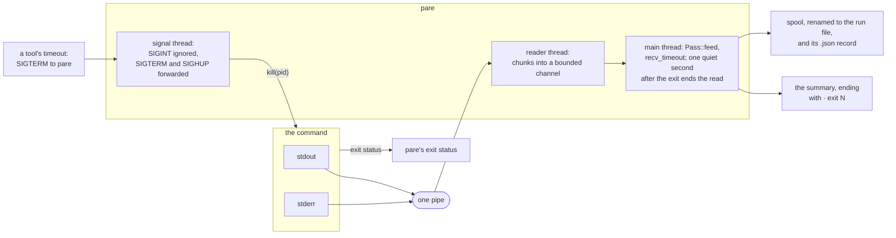

# pare: architecture

How the Rust code is organised, how data flows through it, and where it
differs from the Python prototype it began as (`reference/pare.py`), which
is kept frozen as the reference the binary is tested against byte for
byte. What the algorithm does and why is in [DESIGN.md](DESIGN.md); what
is Rust-specific, explained for a C++ reader, is in [RUST.md](RUST.md);
setting up, building and testing are in
[CONTRIBUTING.md](../CONTRIBUTING.md). The port's stages are recorded in
[ROADMAP.md](../ROADMAP.md), stage 5.

Every mode and flag of the Python version is here, with the same output
under `PARE_REFERENCE_RULES=1` ("Testing" below): over every log in the
repository and the generated edge cases, under 14 flag sets, every
output and exit status is identical, and in batch mode so is every
line's record, depth, severity, template, score and sizes, and every
template's counts, marker, salience and text, scores to the bit
(`bench/check.sh` prints the current run count). Rules added since the port
(structured lines, the tail window's verdict rule, `auto` as the default
budget, the binary-input check, and the smaller changes "Output marks
and the reference switch" lists) are what the switch turns off.

## Crate layout

One package with a library and a binary:

```
Cargo.toml          dependencies, lints, release profile
src/main.rs         the binary: hands the arguments to cli::run, nothing else
src/lib.rs          the library root: module list and crate docs
src/cli.rs          options and the prune/stats/vocab subcommands, checks, dispatch,
                    batch mode
src/error.rs        Error (Usage, Io) and exit statuses
src/budget.rs       Budget: tokens <-> bytes, as tokens()/budget_bytes_for();
                    an automatic budget's pass-through and window sizes
src/pass.rs         Pass: chunks in, lines out, spool and hash on the way;
                    Segmenter: lines into records, heads into templates
src/store.rs        Store: per-line, per-record and per-template columns
src/text.rs         clean_line, indent_of, clip: a raw line to its text; Glyphs, the
                    marks the output is built from (--ascii)
src/structured.rs   JSON and logfmt lines: a clip that keeps the telling fields,
                    escaped traces as message and frame, pino's numeric levels
src/mask.rs         the masks (<TS>, <NUM>, ...), a file's UserMasks, drain_message
src/drain.rs        Drain, the template miner (as drain3 0.9.11)
src/vocab.rs        vocabulary classes, levels, HTTP and exit codes, vocab_score;
                    --vocab files and pare vocab
src/score.rs        scoring constants; template salience and markers
src/pyre.rs         PyRegex: Python patterns on two engines
src/pyclass.rs      Python's \w, \d, \s, isdigit, strip, split, int, repr;
                    py_pattern, erase_assertions
src/pyunicode.rs    the tables behind them, generated from Python 3.13
src/dump.rs         $PARE_DUMP, in the Python version's format
src/runfile.rs      run directory, Spool (the file that becomes the run file)
src/runs.rs         `pare prune` and automatic pruning, `pare stats`
src/command.rs      command mode: running CMD, its output, signals, the .json record
src/follow.rs       follow mode: windows, flushes, the end line
src/select.rs       --only, --except, --since, --until, --min-severity
src/pyjson.rs       JSON as Python's json.dump(indent=2) writes it
src/summary.rs      output: verbatim pass-through, or the summary (allocation,
                    rendering, the exact fit)
tests/cli.rs        end-to-end tests of the binary
tests/data/         golden files from the Python version: mask.tsv (mask() on
                    4,045 record heads), vocab.tsv (severity, classes and
                    scores of 6,032 lines), vocab.txt and vocab-example.txt
                    (pare vocab), summary/ (whole summaries of 5 logs)
```

The library holds everything so that each piece has unit tests next to it
and documentation as an API (`cargo doc --open`); `main.rs` is a few
lines.

## The command line

`cli::Args` is a clap derive struct; the doc comment on each field is its
help text, `help_heading` groups the flags (Summary, Selecting from a run
file, Run files, Follow mode, Vocabulary), and `after_long_help` adds the
environment variables and exit statuses to `--help` but not to `-h`.
`cli::Cmd` holds the three subcommands that do not summarise (`prune`,
`stats`, `vocab`); `--run-dir` and `--vocab` are `global`, so they apply
to a subcommand as well as to a summary. Two things happen before clap
sees the arguments: `cli::run` splits them at the first `--`, so a
command to run is never parsed as flags (as Python's `main()` did), and
`Args::resolve_budget` reads `$PARE_BUDGET` itself rather than through
clap's `env`, so an empty variable counts as unset and the error names
the variable. `dispatch` then runs the checks in the Python version's
order, sets the output marks (`text::set_ascii`) once, builds the
vocabulary once and lends it to the pass, and hands off to a subcommand,
follow mode or batch mode.

## Data flow (batch mode)

```
stdin ──read 1 MiB──▶ Pass::feed ──▶ spool file (write as read)
                         │       └──▶ SHA-256 (hash as read)
                         │  (a NUL in the first 8 KiB: binary; spooled and
                         │   hashed, no further, and batch prints one line)
                         ▼
               split on '\n' (memchr), a line cut by a chunk carried over
                         │
                         ▼
               Segmenter::add_line
                 clean_line(raw); offset, length, rendered and stripped sizes
                 severity: level token, HTTP status, exit code (vocab::Vocab)
                 blank?           ─▶ ends the record (one blank may stay in a block)
                 continuation?    ─▶ joins the open record: deeper indent, or a
                                     frame/caret/`Caused by:`/... shape (the vocabulary's
                                     continuation class, Vocab::continues),
                                     within one logcat entry (LOGCAT_HEADER)
                 otherwise        ─▶ starts a record: drain_message(text)
                                     = mask(text, the vocabulary's [mask NAME]s)
                                     ─▶ Drain::add ─▶ template;
                                     the template's levels and exemplar
                 score            ─▶ vocab_score, plus for a continuation a share
                                     of the head's, less depth; location bonus
end of input ─▶ Pass::finish ─▶ Store + hash + spool
                 (each template takes its cluster's final text)
                         │
     spool renamed to <run dir>/<hash12>.log (Spool::persist), unless --no-tee
                         │
                         ▼
               score::score_templates: salience and marker per template
                 (reads each exemplar's record body back from the spool)
                         │
                         ▼
               $PARE_DUMP set? ─▶ dump::write_dump
                         │
               summary::passthrough: fits the budget? (auto: twice the ceiling)
                  yes ─▶ read lines back by offset, clean, write
                  no  ─▶ summary::summarize
                           head and tail windows (at most 30 % of the budget;
                             auto: of 2,000 tokens at most)
                           one queue: template entries at their salience,
                             raw lines at their score per byte, less for
                             each repeat of a shape already shown
                           place greedily; offer what did not fit against
                             the measured slack; render, measure, shed
                             until it fits the budget exactly
                           (auto: templates below salience 3 get no entry,
                             so the queue runs dry before the ceiling)
```

This is the Python version's single pass and summary, in the same order.
With a selection flag, `select::select` prints the chosen records' raw
lines instead of the summary. In command mode the input is the command's
merged stdout and stderr (`command::CommandRun`), read on a thread, and
the exit status is the command's.

## Follow mode

`follow::follow` feeds the stream to the same pass and cuts a window at
each flush (`Segmenter::cut`): after `--every` lines, but only where a
record starts (`Segmenter::window_full`), after `--interval` seconds,
`--settle` seconds after an error line (at most once per
`--min-interval`), and at the end. Drain, the templates' ids (`gid`,
shown as `T<n>`) and their cumulative counts, the line counter and the
spool offset carry across windows; each window gets its own `Store`,
numbered from its first line (`Store::base`). A record open at a cut is
carried (`store::CarriedHead`): the next window's first lines may
continue it, and the summary shows its head, from the previous window,
as `(cont.)`. The windows therefore segment exactly as one batch pass
does, which a unit test checks (`follow_windows_segment_as_batch_does`);
USAGE.md's "Follow mode" draws the four cuts on one stream.
Each window is scored and summarised like a batch input, with a novelty
bonus for templates first seen in it; a window with nothing worth showing
is one line, or none with `--quiet`.

The Python version waits on stdin with `select()` and a timeout so it
can flush on time while the stream is idle. Here a thread reads the
stream into a bounded channel (`command::read_in_background`) and the
main loop waits on the channel with `recv_timeout`: the same effect,
with no platform-specific polling, and it builds on Windows.

The vocabulary is built once in `cli::dispatch` (the built-in one, or
with `--vocab` applied) and lent to the pass: `Segmenter<'v>` holds a
`&'v Vocab`, where Python reads a global `VOCAB`.

## Command mode

`command::CommandRun` runs `CMD ARGS` with one anonymous pipe as both
its stdout and stderr, so the two interleave as written. A reader thread
moves the pipe's chunks into a bounded channel; the main thread feeds
them to the same pass as stdin, waiting with `recv_timeout` so follow
mode's timers still fire. Once the child has exited, one quiet second
(`EXIT_GRACE`) ends the read even if a leftover process holds the pipe
open. A `signal-hook` thread ignores SIGINT (the terminal's Ctrl-C
reaches the child on its own) and forwards SIGTERM and SIGHUP, which a
tool's timeout aims at pare alone. The exit status is the child's, and
the `.json` record goes next to the run file.



## Matching Python's character classes and regexes

Three things had to be exactly Python's for template ids and scores to
match:

- **Character classes.** Python's `re` and Rust's `regex` disagree on
  `\w` for about 8,000 characters (Rust counts combining marks and
  connector punctuation, Python counts superscripts and other numbers),
  on `\d` for Unicode 16's new digits, and on whitespace for U+001C to
  U+001F. `bench/gen_pyunicode.py` writes Python 3.13's classes into
  `src/pyunicode.rs` as range tables; `pyclass::py_pattern` rewrites a
  pattern's `\w`, `\d`, `\s` and `\b` to use them, and `py_isdigit`,
  `py_isspace`, `py_strip` and `py_split` look them up. CI checks the file
  is current. In `mask("x\u{301}5")` the 5 is a number to Python and not
  to Rust's built-in `\w`; a unit test pins it.
- **Lookaround.** Python's masks and vocabulary use `\b`, lookahead and
  lookbehind, which the linear-time `regex` crate does not have and the
  backtracking `fancy-regex` crate does. Scanning a line with
  `fancy-regex` made the pass slower than Python's (25 s on 30 MB). So a
  `pyre::PyRegex` holds two forms of each pattern: Python's, and the same
  with its assertions erased (`pyclass::erase_assertions`). `regex` scans
  for the leftmost place the relaxed pattern matches; `fancy-regex` tries
  Python's pattern only there, anchored with `\G` (it still sees the text
  before, for lookbehind). Erasing assertions only relaxes a pattern, so
  every place Python's can match is a candidate and none is missed; a
  test checks that on corpus lines, and golden files of Python's results
  check the outcome. Masking became 14 times faster. A pattern without
  assertions runs on `regex` alone; the `fancy-regex` half is compiled on
  its first candidate, which keeps start-up at about 20 ms.
- **Case-insensitivity.** Python's `(?i)` equates `İ` and `ı` with `i`,
  and Rust's does not; and Rust's folds the members of a class, so
  Python's word table under `(?i)` would gain characters (U+0345, which
  folds to a Greek iota) that Python's `\w` does not have.
  `pyclass::py_pattern` adds `İ` and `ı` wherever an `i` can match and
  shields Python's classes with `(?-i:...)`. The level token found must
  then also be one of the vocabulary's once uppercased (`İNFO` matches
  `info` case-insensitively but is not `INFO`), as in Python.

## The summary: closures as a struct

Python's `summarize()` is one function of about 750 lines whose
closures (`place`, `effective`, `list_affixes`, `rare_failures`,
`render`, `shed`, ...) share and change its locals: the queue, the lines
shown, a dozen memo tables. Rust does not let two closures borrow the
same variable mutably at once, so the port makes the locals the fields
of a private `Summarizer` struct and each closure a method of the same
name, in the same order; the two read side by side. Lines are read back
from the spool when the summary looks at them and cached with what was
worked out about them (`Facts`: vocabulary classes, masked shape, name
key, parameters), as Python's `Line.memo`; a scan over many lines
(`rare_failures` looks up to 200,000 lines back for a failure's section
header) reads them in blocks and keeps none.

The queue is Python's `heapq` of `(-priority, kind, id)` tuples: a
`BinaryHeap` of `Reverse<Item>`, with `Item` ordered as the tuple is,
`-0.0` and `0.0` equal. Every choice depends on exact float comparisons
(a stale priority is detected by `!=`), which is why the scores had to
be bit-identical to the reference's before the summary could be.

A summary costs little next to the pass: a few hundred milliseconds of
the 4.4 s a 30 MB log takes (DESIGN.md, "Performance").

## Output marks and the reference switch

The marks pare's output is built from (`→ · × – ┆ … ≤ ↳ ⏎ ‹›`) come
from one table, `text::Glyphs`, read through `text::glyphs()` at every
site that writes one: the header, the gap markers, the ledger, the list
items, the clip marker, a follow block's `↳ continues`, a decoded
trace's `‹…⏎…›`. `--ascii` switches the table (`text::set_ascii`, once,
before any output) to `-> | x - | ... <= -> \n <>`. Producing the marks
rather than substituting them in the finished text is what keeps two
promises: a log line that happens to contain `→` is never rewritten, and
the budget is measured on the bytes actually written, since every size
the allocator sees is of a rendered string.

`pass::rust_rules()` is the one switch between the reference's output and
pare's own: true unless `PARE_REFERENCE_RULES` is set. It gates
structured lines (`text::clip`, `vocab`'s numeric levels), the tail
window's verdict rule (`Summarizer::windowed`), `auto` as the default
budget (`cli::Args::budget_for_summary`), the binary-input check
(`Pass::check_binary`), the usage exit status
(`error::Error::exit_status`), the expand-with hint's dependence on a
run file and the ledger's singular forms (`summary`). The parity check
and the golden-summary test set the variable; everything else runs with
the rules on. `grep -rn "rust_rules()" src` is the current list.

## Memory model

The input's text is never held in memory. The `Store` keeps, per line, a
`u64` offset into the spool, a `u32` length, its record (`Option<u32>`),
depth, rendered and stripped sizes (`u32`), a blank flag, a severity
(`Option<u8>`) and a score (`f64`): about 43 bytes a line; per record
its first and last line and template (12 bytes); and the templates. A
line's text is read back from the spool when the output needs it. Drain
keeps its clusters' tokens and its prefix tree, which grow with the
number of distinct shapes, not with the input. The compiled patterns and
the `regex` crate's search caches take about 15 MB, which is most of a
small log's footprint. Measured times and peak memory, on one stated
log, are in DESIGN.md, "Performance", and the Python version's in
HISTORY.md, "Performance of the Python version".

## Errors and exit statuses

Failures are values (`error::Error`), passed up with `?` and reported in
one place, `cli::run`, which prints `pare: ...` on stderr and returns the
status:

| status | meaning |
|---|---|
| 0 | success (also `--help`, `--version`, and a reader that closed the pipe) |
| 1 | an I/O error: reading the input, writing the run file or the output |
| 2 | a usage error: clap's (an unknown flag or value, a count or budget below its floor) or pare's (flags that contradict each other, a bad `--vocab` file or `$PARE_BUDGET`), with the Python version's messages where it has them; 1 under `PARE_REFERENCE_RULES`, the Python version's status |
| the command's | command mode: the command's own status (128 + n if a signal killed it; 127 not found, 126 not executable) |

## Testing

- **Unit tests** sit at the bottom of each module (`#[cfg(test)] mod
  tests`), and code examples in `///` docs are compiled and run as tests.
- **Integration tests** in `tests/cli.rs` run the binary: pass-through,
  the run file and its name, empty and binary input, usage errors, the dump against
  Python's, `pare vocab`, bad vocabulary files, whole
  summaries against Python's (`tests/data/summary/`), the budget as a
  hard limit, the run line, command mode and its records, `pare stats`,
  `pare prune`, follow mode.
- **Golden files** in `tests/data/`, written by `bench/gen_fixtures.py`
  from the Python version: `mask()` on 4,045 real record heads and
  awkward Unicode lines; severity, vocabulary classes and both
  `vocab_score`s of 6,032 lines (the scores as `repr()` strings, compared
  bit for bit); `pare vocab` with and without `reference/vocab.example`.
- **Parity** (`bench/parity.py --candidate target/release/pare`)
  compares the binary with the Python version byte for byte over every
  corpus log and the generated edge cases, under 14 flag sets; `--dump` also compares the per-line results and reports the first
  row that differs. It runs the binary with `PARE_REFERENCE_RULES=1`
  (`pass::rust_rules`; "Output marks and the reference switch" above),
  as the golden-summary test does; the rules behind the switch have
  tests of their own.
- **CI** (`.github/workflows/ci.yml`, Linux): `cargo fmt --check`, `cargo
  clippy -D warnings`, `cargo test`, `cargo doc` with warnings as errors,
  the Python test suite on Python 3.13, that `src/pyunicode.rs` is what
  `bench/gen_pyunicode.py` writes, parity with `--dump`, and packaging:
  `cargo package`, the maturin wheel installed and run, `install.sh`
  against a release laid out on disk, and the Homebrew formula rendered.
  `bench/check.sh` runs the same jobs locally, in the same order, and
  `.githooks/pre-push` runs it before a push (CONTRIBUTING.md, "The
  checks CI runs").

## Builds and releases

`cargo build --release` gives `target/release/pare`, about 3.4 MB,
stripped, with link-time optimisation. The package is `pare-cli` (the
name `pare` is taken on crates.io and PyPI); `Cargo.toml` names its
library and binary `pare` (`[lib]`, `[[bin]]`), so the code says
`use pare::...` and the command is `pare`.

`.github/workflows/release.yml` runs on each version tag (`v0.2.0`, not
`v0.1-python`) and publishes:

- archives for `x86_64-unknown-linux-musl` and `aarch64-unknown-linux-musl`
  (statically linked, any Linux), `aarch64-apple-darwin`,
  `x86_64-apple-darwin` and `x86_64-pc-windows-msvc`, with `SHA256SUMS`,
  to a GitHub release (`install.sh` and `cargo binstall` download these);
- a Homebrew formula pointing at them, tested with Homebrew and pushed to
  the `wspires/homebrew-tap` repository;
- PyPI wheels built by maturin (`pyproject.toml`, `bindings = "bin"`):
  the binary in a wheel, for `pipx install pare-cli`;
- the crate, to crates.io.

RELEASING.md has the checklist and the one-time setup.

## Dependencies

Each one earns its place; the binary has no C dependencies, which is what
makes the static build and cross-compilation trivial.

| crate | why |
|---|---|
| `clap` (derive, env) | the standard argument parser; derives the parser, the subcommands and the grouped help from `Args` and `Cmd`, accepts unambiguous prefixes like argparse, reads `$PARE_VOCAB` (`$PARE_BUDGET` is read by `Args::resolve_budget`, so an empty value can count as unset) |
| `regex` | linear-time regular expressions (RE2-style): the ANSI pattern, segmentation, and the scanning half of every mask |
| `fancy-regex` | backtracking regular expressions with lookaround and `\G`, like Python's `re`: the exact half of the masks, tried only at the positions `regex` finds |
| `memchr` | SIMD byte search for line splitting; already a dependency of `regex`, so free |
| `sha2` | SHA-256 for the run file's name, as `hashlib.sha256` |
| `serde_json` (preserve_order) | reading the `.json` run records (`pare stats`, `pare prune`); writing them is `pyjson`, to match Python's format |
| `signal-hook` (Unix) | command mode's signal handling without `unsafe`: SIGINT ignored, SIGTERM and SIGHUP received on a thread |
| `nix` (Unix, `signal` only) | sending those signals on to the command (`kill(2)`), which std cannot |

## Appendix: the Python reference, symbol by symbol

The `//!` docs of each module name its Python counterpart; this table is
the same map in one place, for reading the two side by side.

| Python (`reference/pare.py`) | Rust |
|---|---|
| `main()` options and checks | `cli::Args`, `cli::dispatch` |
| `main()` batch path | `cli::batch` |
| `sys.exit("pare: ...")` | `Error::Usage`, printed by `cli::run` |
| `tokens()`, `budget_bytes_for()` | `Budget::tokens_in`, `Budget::bytes` |
| `analyze()` | `pass::read_all` |
| `Pass.feed()`, `Pass.finish()` | `Pass::feed`, `Pass::finish` |
| `Pass._add()` | `pass::Segmenter::add_line` |
| `VOCAB_CLASSES`, `DEFAULT_VOCAB`, `Vocab`, `Vocab.has()` | `vocab::Class`, `vocab::DEFAULT_VOCAB`, `vocab::Vocab`, `vocab::Line::has` |
| `Vocab.detect_level()`, `.severity()`, `http_severity()`, `exit_severity()` | `Vocab::detect_level`, `Vocab::severity`, `vocab::http_severity`, `vocab::exit_severity` |
| `vocab_score()`, `LEVEL_ONLY_RX`, `STACK_FRAME_RX` | `vocab::vocab_score` |
| `parse_vocab()`, `dump_vocab()` | `vocab::parse_vocab`, `vocab::dump_vocab` |
| `score_templates()`, `rarity_of()`, `INHERIT`, `DEPTH_PENALTY`, ... | `score::score_templates`, `score::rarity`, `score::INHERIT`, ... |
| `re.compile(...)` of a pattern with lookaround | `pyre::PyRegex::new` |
| `Pass._joins()`, `continuation_rx()`, `LOGCAT_HEADER_RX` | `Segmenter::joins`, `Vocab::continues` (the continuation class's entries), `pass::LOGCAT_HEADER` |
| `Store` arrays, `Store.raw()` | `Store` columns, `Store::for_each_raw` |
| `Template` | `store::Template` |
| `clean_line()`, `ANSI_RE`, `indent_of()`, `clip()` | `text::clean_line`, `text::ANSI_RE`, `text::indent_of`, `text::clip` |
| `MASKS`, `MASK_NEEDS`, `mask()`, `drain_message()` | `mask::SPECS`, `mask::mask`, `mask::drain_message` |
| `Drain` | `drain::Drain` |
| `str.isspace()`, `.isdigit()`, `.isupper()`, `.strip()`, `.split()`, `int()`, `repr()`, re's `\w` `\d` `\s` `\b` | `pyclass::py_isspace`, `py_isdigit`, `py_isupper`, `py_strip`, `py_split`, `py_int`, `py_repr`, `py_pattern` |
| `write_dump()` | `dump::write_dump` |
| `default_run_dir()` | `runfile::default_run_dir` |
| spool `.pare-<pid>.tmp`, `os.replace`, cleanup in `finally` | `runfile::Spool` (`persist`, `Drop`) |
| `summarize()` pass-through branch | `summary::passthrough` |
| `parse_lineno()`, `parse_tids()`, `select()` | `select::parse_lineno`, `select::parse_tids`, `select::select` |
| `CommandRun`, `CommandOutput`, `write_meta()` | `command::CommandRun`, `command::CommandOutput`, `CommandRun::write_meta` |
| `follow()`, `CountingWriter`, `FollowInfo` | `follow::follow`, `follow::Counting`, `summary::Follow` |
| `Pass.cut()` (template texts and totals), `_new_window()`, `_rate_notes()`, `CarriedHead`, `GlobalTemplate` | `Segmenter::cut`, `new_window`, `rate_notes`, `store::CarriedHead`, `pass::Global` |
| `prune_runs()`, `maybe_prune()`, `prune_command()`, `stats()` | `runs::prune_runs`, `runs::maybe_prune`, `runs::prune_command`, `runs::stats` |
| `json.dump(..., indent=2)`, `float.__repr__`, `format(x, "g")`, `time.strftime(..., gmtime())` | `pyjson::dumps`, `pyjson::py_float_repr`, `runs::py_format_g`, `runs::utc_stamp` |
| `summarize()` and its closures | `summary::summarize`, `Summarizer` methods of the same names |
| `Line.memo`, `line_has()`, `line_params()`, `name_key()`, `shape_key()`, `is_chatter()`, `is_error_line()` | `summary::Lines` and `Facts` |
| `is_near_duplicate()`, `token_set()`, `fmt_int()`, `render_ranges()`, `nbytes()` | `Summarizer::is_near_duplicate`, `summary::token_set`, `fmt_int`, `Summarizer::render_ranges`, `nbytes` |
