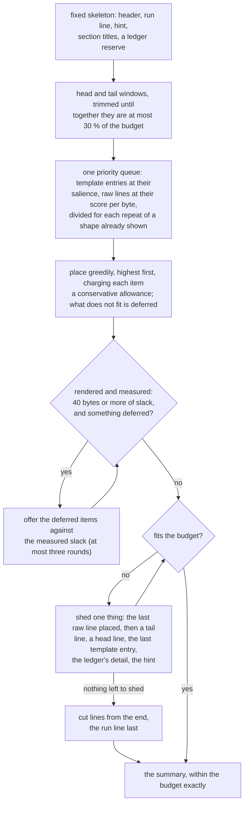

# pare: design notes

How pare works and why: the algorithm, how it differs from Drain, what
"tokens" means here and how to pick a budget, the pipeline, the
structural and vocabulary signals, the scoring model and the allocation,
command and selection modes, the tool-specific rules, performance and
follow mode. Each rule says what
it is and, in a sentence, what it earned. The experiments behind the
rules, in the order they were run and with the numbers of the time, are
in [HISTORY.md](HISTORY.md); the current benchmark numbers are in the
README and `corpus/heldout/README.md`; the Rust code's organisation is in
[ARCHITECTURE.md](ARCHITECTURE.md) and the flags in [USAGE.md](USAGE.md).

## The algorithm at a high level

The core idea: noisy command output is mostly a small number of line
*shapes* repeated thousands of times, plus a handful of lines that are
actually different. pare finds the shapes, counts them, and spends the
token budget on the handful.

1. **Save everything first.** Stdin is written to a run file named by its
   content hash before anything else happens. The summary is a view, not a
   replacement; every line it omits can be pulled back by template id or
   line range from that file.
2. **Group lines into records.** A log is not really line-oriented. A stack
   trace is one unit, so is a compiler diagnostic with its code snippet. A
   line indented deeper than the line above, or shaped like a frame
   (`at foo.py:12`), a caret marker or a `Caused by:`, is attached to the
   record above it. Each record has a head line, which is what gets
   clustered, and a body.
3. **Mask the variable parts.** Timestamps, IPs, hashes, paths, numbers and
   runs of rule characters become placeholders, so
   `2026-10-07 ERROR [worker-3] GET /api/cart 500 1137ms` and the same line
   from worker-5 a second later look identical:
   `<TS> ERROR [worker-<N>] GET <PATH> <NUM> <NUM>`.
4. **Cluster into templates.** The masked head lines go through Drain, a
   streaming log-template miner. It keys a parse tree on token count and
   the first tokens, and merges lines whose tokens agree above a similarity
   threshold, turning the differing tokens into wildcards. The result is a
   few dozen templates with counts: `T4 ×4,340 INFO http …`,
   `T9 ×180 ERROR http … 500`, `T12 ×1 FATAL giving up`. The 4,340 INFO
   lines have just become one line of output.
5. **Score salience.** Two signals, in priority order. First, *structural*
   severity: an explicit log level in a level position, an HTTP status in a
   request line, an exit code. These are language-independent and override
   words: an INFO line that says `0 errors` is info; an ERROR line is an
   error in German. Second, *vocabulary*: error words +3, warning words
   +1.5, summary words +1, stack frames +1, passing-test markers and
   progress chatter negative. A template's salience is its exemplar head's
   score plus a rarity term, `2 / (1 + log2 count)`, so a line seen once
   outranks a shape seen a thousand times. A raw line's score is its own
   vocabulary plus 0.6 of its record head's, so a bland stack frame under
   an ERROR head still rates, plus a bonus if it is the first location after
   an error message.
6. **Fill the budget with one priority queue.** Head and tail windows are
   placed first, since the command line and the final verdict usually live
   there. Then template entries and individual raw lines compete in a
   single queue on the same scale. A template entry costs one line and buys
   a count and an exemplar. A raw line is worth its score divided by
   `1 + 1.5 × (lines of that shape already shown)`, so the first `503` is
   valuable, the second less, the twentieth nothing. Lines under a floor
   never pad the output. Lines that land inside a placed template's
   exemplar record render under it as its body, which is how a traceback
   appears as one block. Guards drop restatements: a progress line that
   repeats the summary line, an exemplar already in the tail window.
7. **Enforce the limit and end with a ledger.** Allowances are
   conservative, so a second pass re-offers what did not fit against the
   measured slack; then a final loop sheds the lowest-priority items until
   the rendering fits. The budget is a hard ceiling. The last lines say what
   was omitted and from which templates, and where the raw file is.

Two properties fall out of this. It is deterministic, so template ids are
stable and `pare --only T9` means the same thing tomorrow. And it is
learned per input rather than per tool: nothing in it knows what pytest or
cargo output looks like except a short list of continuation shapes, and
with those switched off it still keeps 88 % of must-survive lines at a
600-token budget. The limits: the vocabulary is an English prior, the
severity forms are a finite list, and it only makes sense on line-oriented,
repetitive input. On a diff, a JSON blob or prose there is nothing to
cluster and it degrades to head, tail and whatever matches the word lists.

## How this differs from Drain

Drain ([He et al., 2017](https://jiemingzhu.github.io/pub/pjhe_icws2017.pdf);
pare carries its own copy of the core of
[drain3](https://github.com/logpai/Drain3) 0.9.11, the Python
implementation, MIT-licensed) is a *log parser*: given a stream of lines it decides, online,
which template each line belongs to and which tokens are parameters. Its
output is the complete set of templates and a cluster id per line. It has
no notion of which templates matter, no budget, and no output format
beyond that.

pare uses Drain for exactly step 4 above and supplies everything around it:

- **Records, not lines.** Drain sees one string per call. pare segments
  the input into records first and clusters only the head line of each,
  so a 40-line stack trace is one record under one template rather than
  40 clusters of frames. The body travels with the head.
- **Masking before Drain, on pare's terms.** drain3 has its own masking
  hooks; pare masks first with placeholders chosen for developer-tool
  output (paths that must contain a letter, versions, units, rule runs)
  and hands Drain the masked text. The built-in copy has no masking of
  its own (nor drain3's persistence, cluster limit or extra delimiters),
  which keeps the shapes under pare's control and the clustering
  deterministic.
- **Stable ids.** Drain numbers clusters in creation order; pare renumbers
  them by first appearance, takes each cluster's final template text after
  all records are in, and clusters exactly as drain3 0.9.11 does so `T9`
  means the same thing across runs of the same input and across pare
  versions. pare depended on drain3 until the core was vendored (a single
  file with no dependencies is easier to install); `test_pare.py` checks
  the copy against drain3 on every line of every log in the repository
  and on random messages that fill a tree node past its child limit, and
  the summaries of every log, at several budgets and in follow mode, were
  byte-identical before and after.
- **Salience and allocation.** Everything from step 5 on is pare: the
  structural severity, the vocabulary, the exemplar choice (the
  highest-severity record of each template), the priority queue, the
  diminishing returns, the hard budget, the ledger and the selection
  modes. Drain would list the 4,340 INFO lines' template and the FATAL
  line's template as peers; pare decides that one of them is worth 120
  bytes of a 2,400-byte budget and the other is worth one line in the
  ledger.

Drain could be swapped for any template miner that gives stable clusters
over masked head lines, but template ids must stay stable across
versions or `--only T3 < runfile` breaks: a replacement must cluster
exactly as drain3 0.9.11 does, or the change is a breaking one and must
say so. The Rust `drain.rs` is held to the Python copy, and that copy to
drain3, by tests on every log in the repository.

## Tokens and the budget

**What a token is here.** pare counts tokens as `ceil(bytes / 2.0)` of
UTF-8 text, for its own output and for the budget, and the benchmark
uses the same rule for every tool. This is a proxy, not a tokenizer: 2.0
is the rate measured on Claude's tokenizer below, and
`--bytes-per-token` changes it (2.8 is the rate on OpenAI's cl100k and
o200k, and the default until 29 October 2026; 4 is the rule of thumb for
English prose, the unit the heuristics were first developed in). Log
text is denser in tokens than prose because paths, hashes, hex,
punctuation and digits split into many short pieces.

**Measured.** `bench/tokens.py` counts the dev corpus and pare's output
with real tokenizers: OpenAI's cl100k_base and o200k_base through
tiktoken, and the tokenizer behind the current Claude models through
Anthropic's `count_tokens` API (`--anthropic claude-opus-5-5`; Opus 4.7
and later share it). Bytes per token over the nine dev-corpus files, on
29 October 2026:

| text | cl100k | o200k | Claude Opus 5.5 |
|---|---|---|---|
| raw corpus, 1.63 MB | 2.59 | 2.59 | 1.80 |
| pare output at budget 600 | 2.82 | 2.82 | 1.96 |
| pare output at budget 2000 | 2.85 | 2.83 | 1.96 |

Per file, Claude's rate on pare's output runs from 1.78 to 2.14 bytes
per token, a third denser than the OpenAI tokenizers; the raw logs range
more widely (2.1 on the synthetic service log, with timestamps, IPs and
hex on every line, to 3.8 on the pytest run, in cl100k), and pare's
output sits in a narrower band. So at 2.8 a Claude agent got more than
the budget said: `--budget 2000` printed about 2,870 Claude tokens and
`--budget 600` about 860. At 2.0, rerun the same day, the budget-2,000
outputs count at most about 2,040 Claude tokens and the budget-600 ones
about 610: the budget holds to within 2 %. The same nominal budget is a
30 % smaller summary, and on the recall benchmark that costs 25 points
at 600 on the dev corpus (78 % to 53 %), 16 on Defects4J seed 7 (90 % to
74 %) and 17 on SWE-bench seed 5 (62 % to 45 %), and one to five points
at 2,000. The README's tables are at the new rate; every number in
HISTORY.md and in the held-out record before that date is at 2.8, and
the earlier calibration (the bytes/4 era, and the legacy public Claude
tokenizer) is in HISTORY.md, "Calibrated to real tokens". For a strict
ceiling on the densest logs set `--bytes-per-token 1.8`, the lowest
per-file rate measured; `2.8` reproduces the numbers from before
October.

**How to set the budget.** The budget is a hard ceiling on what reaches
the agent's context, and the ledger plus run file make everything above
it recoverable on demand, so the question is how much context one tool
result should cost by default:

- For an agent loop, 1,000 to 2,000 tokens per tool call. At 2,000 pare
  keeps 99 % of the dev corpus's must-survive lines at 1.6 % of the
  input, and every line of the latest held-out samples (README,
  "Results"); at 1,000 it keeps 92 % and 70 % of those two samples.
- A budget of 600 is 1,200 bytes, too little for a run with several
  failures: 53 % on the dev corpus, 86 % and 56 % held out. Below about
  600 the fixed skeleton (header, windows, ledger) is most of the output.
- Small outputs are passed through untouched when they fit, so a high
  budget costs nothing on a 50-line command; the budget only bites on
  output that needs it.
- Spend more only when needed: start at the default, and when the summary
  points at a template or line range, pay for that slice with
  `--only T9 --min-severity error` or `--since L3001 --until L3100` rather
  than by raising the budget for every call.

The right number ultimately depends on the context window and how many
tool calls a task takes; a 200k-token window with 40 tool calls at 2,000
each spends 80k on tool output, which is the kind of arithmetic the
budget exists to make explicit.

### Automatic budget

`--budget auto` treats the budget as a ceiling (2,000, or
N with `auto:N`) that the summary need not reach. (The measurements in
this section are at 2.8 bytes per token, the rate when `auto` was tuned;
the ones at 2.0 are at its end.) The allocator already
places entries in order of salience; under `auto` it stops once nothing
worth an entry of its own is left, so a log with one error gets a short
summary and a log with many errors gets more, up to the ceiling. Three
things change, and nothing else:

- **Template floor 3.0 instead of 1.5.** Only shapes at error level get a
  template entry; warnings and summaries still compete as raw lines,
  under the unchanged line floor (1.0), and still appear in the ledger.
- **Pass-through up to 1,000 tokens** (or the ceiling, if lower) instead
  of up to the budget. A fixed budget of 2,000 passes a 1,900-token log
  through whole; that was 77 of the 179 benchmark cases and 41 % of the
  output tokens.
- **Head and tail windows sized for 2,000 tokens** at most, so a higher
  ceiling does not lengthen them.

Tuned with `bench/run.py --pare-bin target/release/pare` over all 179
cases (the corpus, the generated corpus, Defects4J dev, and the
held-out SWE-bench and Defects4J sets), mean output tokens per case and
must-survive lines kept:

| setting | recall | mean tokens |
|---|---|---|
| `--budget 1000` | 93.1 % | 941 |
| `--budget 1500` | 97.4 % | 1,298 |
| `--budget 2000` | 98.8 % | 1,552 |
| `--budget auto:1000` | 92.1 % | 878 |
| `--budget auto` | 97.4 % | 1,204 |
| `--budget auto:4000` | 97.4 % | 1,347 |

`auto` keeps what `--budget 1500` keeps at 7 % fewer tokens, and
costs 1.4 points of recall against `--budget 2000` for 22 % fewer. On
the 144 held-out cases alone it is 98.2 % at 1,237 against 98.5 % at
1,598; on the 35 development cases 96.2 % at 1,069 against 99.5 % at
1,363. A higher ceiling adds little (`auto:4000`: 143 more tokens on
average, same recall), which is the point: the size follows the log, not
the ceiling. A small ceiling gains little over a fixed budget of the same
mean size (`auto:1000` against the fixed curve: about half a point).

What was tried and dropped: a higher line floor (2 or 3) saved tokens but
lost the bodies of warnings (Terraform's check failures, whose lines
score as a share of their head), costing more recall than a smaller fixed
budget would; a template floor of 3.5 or 4 cut entries that carried
must-survive lines. The output's size per case now ranges from about 700
tokens (deciles: 685 to 1,984) instead of crowding at the ceiling (957 to
1,990); 26 cases still reach it, against 40.

The thresholds were tuned on every set, held-out ones included, so the
held-out numbers above are not an unbiased estimate; the next fresh
sample should be scored with `auto` before it becomes the default.
The first one, Defects4J seed 6 (19 bugs, drawn after `auto` was
tuned), keeps 40 of 40 must-survive lines with `auto` at 21,086 tokens,
as `--budget 2000` does at 29,565 (`corpus/heldout/README.md`). The
second, SWE-bench seed 4 (18 tasks), keeps 29 of 30 with `auto` at
18,698 tokens, the same as `--budget 2000` at 24,357; its one miss is
the same at every budget and is not `auto`'s. Defects4J seed 7 and
SWE-bench seed 5 agree: `auto` keeps what 2,000 keeps (37 of 37, 27 of
27) at 69 % and 79 % of its tokens.

**The default since.** With four fresh samples where `auto` loses
nothing against `--budget 2000` and costs 21 to 31 % fewer tokens, it is
pare's default: no `--budget` means `auto` (at most 2,000), and a number
is a fixed budget as before. (Those figures are at 2.8 bytes per token;
at the 2.0 default `auto` keeps what 2,000 keeps on the same two samples
at 77 % and 83 % of its tokens.) The cost is a less predictable output size
(from a few hundred tokens to the ceiling) for the same command.
`PARE_REFERENCE_RULES=1` restores the Python version's fixed 2,000, so
parity is unchanged (it passes `--budget` on every run anyway).

## Pipeline

1. **Tee.** Raw stdin is saved to a run file named by content hash
   (`$PARE_RUN_DIR` or `~/.cache/pare/runs/<sha>.log`), so nothing is lost
   and the same input always maps to the same path. Run files are pruned
   after 14 days, or past 500 MB in all, oldest first and never one under
   a day old (USAGE.md, "Run files"). Input with a NUL byte in its first
   8 KiB (git's and grep's test for a binary file) is saved and hashed
   but not segmented: the steps below are skipped and the output is one
   line saying so, plus the run-file line.
2. **Segment.** Lines become records: a line indented deeper than the
   previous record's head, or shaped like a continuation (stack frame,
   caret marker, `Caused by:`, assertion detail, diff hunk; plus the
   tool-specific shapes listed under **Tool-specific rules**), joins that
   record. Blank lines belong to no record; a single blank line inside an
   indented block does not end it (a tool-specific rule, for Jest and
   pytest). Records are capped at 400 lines.
3. **Mask.** A vocabulary file's own masks run first (none by default).
   Runs of rule characters shrink to three; timestamps, dates,
   times, UUIDs, IPs, URLs, hex and hashes, versions, paths, numbers with
   units, and digits inside identifiers become `<RULE>`, `<TS>`, `<IP>`,
   `<PATH>`, `<NUM>`, `<N>` and so on. Paths must contain a letter, so
   `1/30` is not a path.
4. **Cluster.** The masked head line of each record (first 40 tokens) goes
   through Drain (built in, as drain3 0.9.11 implements it) with
   similarity 0.5, depth 4, max 100 children. Clusters are renumbered `T1,
   T2, …` in order of first appearance; a cluster's final template text is
   taken after all records are in. The clustering must not change, because
   template ids depend on it and `--only T3 < runfile` relies on them.
5. **Score.** See **Scoring model**.
6. **Allocate.** See **Allocation**.
7. **Ledger.** The output ends with how many lines were omitted and from
   which templates, the run-file path, and (at 1,000 tokens and up, when
   there is a run file) a usage hint.

## Structural severity

Before any words are weighed, each line is checked for an explicit severity
in a structural *form*. A level word in the middle of a message
(`connection error occurred`) is vocabulary, not structure.

- **Log levels.** A bare uppercase token near the start of the line
  (`ERROR`, `WARN`), a bracketed one (`[error]`, `(warn)`), a key-value pair
  anywhere (`level=error`, `"level": "warn"`, `severity=CRITICAL`), a prefix
  with a colon (`error:`, `Warning:`), `[I]`, and (tool-specific) rustc's
  `error[E0308]:`, logcat's `E/Tag(` or `E/Tag:` at the line start after an
  optional timestamp and pid/tid, glog's `E0921 10:11:12`, and pytest's bare
  `E` at column 0. The tokens live in the vocabulary file as `level-fatal`
  … `level-debug` so `FEHLER` or `ERRO` can be added with `--vocab`.
- **HTTP status codes** from request lines (`GET /path 503`,
  `"GET /path HTTP/1.1" 503`), key-value pairs (`status=502`,
  `"status_code": 404`) and phrases (`responded with 504`, `returned HTTP
  500`, `HTTP/1.1 302`): 5xx error, 4xx warn, 1xx–3xx info. Bare
  `returned 500` is a row count and does not match.
- **Exit codes** from `exit code 1`, `exit status 2`, `exited with code 137`,
  `exit=0`, `rc=1`, `returncode: 2`: 0 info, 1–127 error, 128 and up or
  negative (signals, OOM kills) fatal. The `rc`, `returncode`, `exit_code`
  and `exit_status` forms require `=` or `:` so `1.4.0-rc1` is not an exit
  code.

A line's severity is the strongest signal on it. It sets the base score
(fatal +4, error +3, warn +1.5, info −0.5, debug −1) and decides whether
error words count: an INFO line saying `0 errors` stays info, an ERROR line
is an error in any language. Per template, the severities of all member
records are tallied; the highest-severity record becomes the exemplar, and
a template whose severity varies shows the histogram (`[ERROR×12 INFO×3,988]`).

## Vocabulary

The salience vocabulary is the one prior in the pipeline that is not learned
from the input, and it is English and developer-tool flavoured. Classes and
weights:

| class | weight | holds |
|---|---:|---|
| `error` | +3 | error, failed, refused, panic, CamelCase `*Error`, `*Exception`, `*Failure` (JUnit's `ComparisonFailure`), `FAIL`, assertion-diff lines (`Expected:`, `Received:`), … |
| `warn` | +1.5 | warning, deprecated, retry, skipped, flaky, … |
| `summary` | +1 | passed, total, finished, `added N packages`, `====` rules, … (record heads only) |
| `frame` | +1 | stack frames and `file.ext:line` locations |
| `pass` | −1 | ✓, PASS, ok: structural, so words in a test name (`✓ throws on invalid`) do not count |
| `noise` | −0.75 | downloading, compiling, debug, progress bars, … (ignored when the line also has an error word) |
| (level only) | −1 | a line that is nothing but a level token (`[ERROR]`, `[WARNING]`, `ERROR:`) says nothing, whatever the level |
| `advice` | −1 | re-run, for more information, please refer to, see dump files, `run with --`, `[Help 1]`, …: a build tool's closing advice. Its score replaces the line's, level included, so an `[ERROR]` advice line stays under the floor |
| `strong-error` | — | decides whether a record *body* makes its template an error |
| `level-fatal` … `level-debug` | +4 … −1 | plain level tokens for the structural detection above |
| `continuation` | — | regexes for lines that continue the record above whatever their indentation: stack frames, carets, `Caused by:`, diff and rustc and pytest detail (segmentation, not scoring) |

Words match whole, case-insensitively, and not inside a hyphenated flag or
identifier (`--timeout=300s` is not an error). A zero count before an error
noun (`0 errors`, `0 failed`) is removed before matching. `pare
pare vocab` prints the lists as a file; `--vocab FILE` or `$PARE_VOCAB`
loads one back, where `[error]` adds to a class and `[error replace]`
replaces it, a plain line is a phrase and a `/.../` line a regex. See
`reference/vocab.example` for a German extension. The `continuation`
class takes regexes only: a `[continuation]` section adds
record shapes the built-in ones do not know, such as a Go panic's frames
at column 0, and `[continuation replace]` can drop built-in ones.
A `[mask NAME]` section is a mask of the file's own: what
its regexes match becomes `<NAME>` before the built-in masks run, for
site-specific ids such as order numbers, tenant names or build hashes
that would otherwise split one kind of line into many templates. There
are no built-in ones, so the default dump has no such section.


Two rules narrow where the classes count. **A stack frame's words are
code names**: on a frame line (`at pkg.Cls.m(…)` in Java, JavaScript and
C#, Python's `File "…", line N, in f`) the error and warn classes do not
count, so `at junit.framework.Assert.fail(…)` is a frame (+1), not an
error line that outranks the exception above it; a compiler's
`src/x.c:8:14: error: …` is a location, not a frame, and keeps its score.
And **a level-only line or an advice line scores −1 whatever its level**
(the two rows above): `[ERROR]` alone, or `[ERROR] -> [Help 1]`, is
printed on every failed Maven build and says nothing about this one. Both
came from held-out Defects4J samples (HISTORY.md, "Maven chatter" and
"JUnit 3 assertion messages").

## Scoring model

A template's salience is what its exemplar head line says plus how unusual
its shape is (the exemplar is the highest-severity record; a real line is
judged, not the masked template text, where `0 errors` has already become
`<NUM> errors`):

    salience = vocab(exemplar head) + 2 / (1 + log2 count) × r

where r is 1, or 0.75 for a template at warning level: a one-off build
warning (2.25 + 1.5) then ranks below a failure seen twice (3 + 1).
Maven's POM warnings are printed once per build and were outranking two
tests failing the same way (HISTORY.md, "JUnit 3 assertion messages").

A raw line's score is its own vocabulary plus a share of its record head's:

    score = vocab(line) + 0.6 × vocab(head) − 0.25 × min(depth, 4)
          + 1.5 if it is the first source location after an error line in its record

where `vocab()` is the structural-severity base plus class weights above
(summary words only on heads). In the queue a raw line's priority is

    score / (1 + 1.5 × repeats of its shape already shown) × (120 / (120 + bytes))^0.35

A record head "repeats" by its drain template and severity (two pods'
readiness warnings are one shape); a continuation line by its masked
shape. Lines under a salience floor of 1.0 never pad the output.

Every term survived an ablation (`bench/ablate.py`, which runs the Python
reference, where each term is a module constant that can be switched off;
the Rust version carries the same weights without the switches; the
original run was in bytes/4 units, the default at the time): switching
it off lowers recall at some budget or grows the output at the same recall. Nine
earlier heuristics did neither and were removed one or two at a time: a
bonus for template entries over lines, start/end position zones, a bonus
for multi-line templates, a bonus for a body with error vocabulary, a bonus
for continuing a record already on screen, decaying returns within one
record, a gentler repeat penalty for error lines, line-level template
rarity, and a first-occurrence bonus.


The dev corpus when the heuristics were frozen, bytes/4 units:

| heuristic | without it: recall@600 / @2000 (out tok @2000 where that is the reason) |
|---|---|
| (the full model) | 97.3% / 100%, 7,567 |
| template rarity | 93.2% / 100% |
| inheritance from the record head | 87.7% / 97.3% |
| depth penalty | 97.3% / 100%, 7,727 |
| error-location bonus | 94.5% / 97.3% |
| value-per-byte factor | 94.5% / 100% |
| repeat penalty | 93.2% / 100%, 9,362 |
| salience floor | 97.3% / 100%, 14,547 |
| near-duplicate suppression | 97.3% / 100%, 7,913 |
| window skipping of frequent templates | 94.5% / 100% |
| compact mode below 1,000 tokens | 89.0% / 100% |
| tool-specific rules (see below) | 87.7% / 94.5% |


Those removals were judged on the same eight dev cases, so "removed" means
"did not help here", not "proven useless". The position terms were the
kind that could matter on logs this corpus did not have: the
**end-of-output bonus** (a final verdict with no error vocabulary, in a
tool whose summary line is not in the tail window) and the
**first-occurrence bonus** (the first instance of a repeated warning when
later copies happen to sit near the end). The others are less likely to
come back: the template bonus and body-error bonus duplicated signals the
queue already has, and the record decay and coherence bonus were
superseded by the repeat penalty and exemplar bodies.

**Re-ablated on nine sets.** The four position terms are back in the code
at weight 0 (`END_TPL_BONUS`, `START_TPL_BONUS`, `END_LINE_BONUS`,
`FIRST_BONUS`), and `bench/ablate.py --corpus DIR ...` switches each on at
the weight it had ("with ..." rows), reporting each set on its own line.
Change in recall, percentage points at 600 / 1,000 / 2,000, at 2.8
bytes per token (* = the latest fresh samples; Defects4J with
alternative-form labels):

| term (old weight) | dev corpus | generated | D4J s1 | D4J s0 | D4J s2 | D4J s3* | SWE s0 | SWE s1 | SWE s2* |
|---|---|---|---|---|---|---|---|---|---|
| end zone, templates (0.5, 1.0 if all records) | 0 / 0 / 0 | +5.3 / −1.7 / 0 | 0 / 0 / 0 | 0 / 0 / 0 | 0 / 0 / 0 | 0 / 0 / 0 | −2.5 / +2.5 / 0 | 0 / 0 / 0 | 0 / 0 / 0 |
| start zone, templates (0.4) | −1.4 / 0 / 0 | 0 / 0 / 0 | 0 / 0 / 0 | 0 / 0 / 0 | 0 / 0 / 0 | 0 / 0 / 0 | 0 / 0 / 0 | 0 / 0 / 0 | 0 / 0 / 0 |
| end zone, lines (0.5) | −1.4 / 0 / 0 | +1.7 / −1.7 / 0 | 0 / 0 / 0 | 0 / 0 / 0 | 0 / −2.3 / 0 | 0 / −3.9 / 0 | 0 / +7.5 / 0 | 0 / +5.7 / 0 | 0 / 0 / 0 |
| first occurrence (0.5) | 0 / 0 / −1.4 | +1.7 / −3.5 / 0 | 0 / 0 / 0 | 0 / 0 / 0 | 0 / 0 / 0 | −2.0 / −3.9 / 0 | +2.5 / 0 / −2.5 | −2.8 / 0 / −14.3 | −9.1 / 0 / 0 |
| all four | +1.4 / 0 / −1.4 | +5.3 / −5.3 / 0 | 0 / 0 / 0 | 0 / 0 / 0 | 0 / −2.3 / 0 | −2.0 / −3.9 / 0 | 0 / +2.5 / 0 | 0 / 0 / 0 | 0 / 0 / 0 |

None earns its place, so all stay at 0. First occurrence is harmful
outright: almost every line of a traceback is the first of its shape
(`def test_none_timeout(self):`, `>  assert r.status_code == 200`,
`E  + where 503 = …`), so the bonus lifts traceback lines over the list of
failing tests; psf__requests-2317 falls from 8 to 3 of 8 at 2,000. The end-zone
line bonus is the only term with a consistent gain on one source
(SWE-bench at 1,000: pytest ends with its verdict and the short summary)
and a consistent loss on another (Defects4J at 1,000: Maven ends with its
build verdict and chatter), so it is a per-tool signal rather than a
general one; the tail window already covers the end. The output-size
columns, not shown, grow with every term on.

## Allocation

The budget is `--budget` tokens at `bytes / 2.0` (`--bytes-per-token`),
and it is a hard limit. In outline, with the rules below filling in each
step:



- A head and a tail window (`--head 5`, `--tail 10`, at most 30 % of the
  budget; the head shrinks to 3 below 1,000 tokens). Lines of templates
  with 5 or more records, and continuation lines of records 20 or more
  lines long, are skipped inside the windows, since the table already
  stands for them; the first and last lines always stay unless they are
  advice or a bare level (Maven ends every failed build with `[ERROR] ->
  [Help 1]`, which was the tail's last line). In the tail window, an
  error line of a skipped template stays when it is the only line of its
  template in the window's span: pytest's own suite prints dozens of
  inner-run `FAILED` lines, and the real verdict near the end was folded
  away, while noise that recurs keeps recurring to the last line
  (HISTORY.md, "The verdict that repeats a shape").
- Then one priority queue for template entries and raw lines on the same
  salience scale. A template entry (count, marker, exemplar head line)
  competes at its salience, so every template is listed once if the budget
  allows, highest first; a raw line competes at the priority above. So a
  high-salience exception line beats a low-salience singleton template, and
  a warning template beats the sixth frame of a trace. Lines that land in a
  placed template's exemplar record are rendered under it as its body (the
  traceback, the compiler snippet); the rest go to "selected lines". A
  template's exemplar head is itself a line candidate, so it can appear even
  when the entry does not make the cut; the entry takes the line over if
  placed later.
- Repeats: a raw line's priority is divided by `1 + 1.5 × n`, where n
  counts lines already shown with the same repeat key. A record head's key
  is its drain template and severity (two pods' identical warnings are one
  shape however the pod names mask); a continuation line's is its masked
  text. The exception is an error line in a template whose records are a
  list of different things: when at least half of the template's records
  (the first 200) have distinct masked shapes, an error head repeats only
  by its masked text. Twelve `FAILED t.py::test_x` lines are one drain
  template with twelve shapes, and each test name is news; crashes of the
  same few pods, over and over, are one template with few shapes per
  record, and stay repeats. A name's bracketed parameters (pytest's
  `test_rolling_iter[numpy-3-True-1]`, JUnit 4's `testX[2]`) stay as
  written in the masked text, so two parametrizations of one test are two
  shapes, and a number inside them is news to the restatement guard
  below.
- Lists of failures are rendered compactly. A list template (as above,
  error lines of mostly distinct shapes, at least 3 records) whose record
  heads share a prefix of 16 bytes or more, cut after a separator, is one
  header with the prefix and `{…}`, then one item line per shown record
  with only the rest:

  ```
  T29  ×17 E FAILED test_requests.py::RequestsTestCase::{…}
    …test_DIGESTAUTH_WRONG_HTTP_401_GET
    …test_HTTP_200_OK_GET_ALTERNATIVE
    ┆ (+15 more)
  ```

  Items still compete one by one in the queue, at their own score, but
  cost (and are valued per byte at) only their rendered length, so about
  twice as many names fit: psf__requests-2317 lists 32 failing tests,
  with pytest's truncated reasons, in about 540 tokens, where as lines
  they cost about 1,000. Judging a list, names are compared with
  identifiers whole (`test_endpoint_get_0` and `test_endpoint_get_1` are
  two tests, where clustering masks `worker3` to `worker<N>`).
  `bench/run.py` expands the form before matching keep lines (`--strict`
  matches the literal text).
- Guards against restatement: a one-line record whose tokens are mostly
  (80 %) contained in a shown line, or a continuation line that is a pure
  token subset of one, is skipped (an error line only when what it adds is
  numbers: `FAILED t.py::test_a` and `FAILED t.py::test_b` share four of
  five tokens, but the fifth is the test); an exemplar the head or tail window
  already prints is referenced (`L308 (in tail)`), not repeated; a
  singleton whose whole record a window prints is not listed.
- A template floor (`TEMPLATE_FLOOR`, 1.5): an entry below that salience
  stays in the ledger, where its count still appears. The first entry is
  exempt. Passing-test templates (vocabulary −1 plus a rarity term that
  cannot reach 2.5 past one record) and `_ _ _ _` separators fall under
  it; a neutral singleton (salience 2.0) does not. Evaluated on both
  corpora: recall unchanged or up at every budget, 10 % fewer output
  tokens at 2,000 (floors of 2.0 and above start losing lines).
- A template whose text equals its masked exemplar (no `<*>` wildcard,
  only mask placeholders) is one line, `T19 ×4 S L183: tests/test_cart.py:14:`,
  since the template text would only repeat the exemplar.
- A template seen exactly twice lists both lines instead of its pattern
  and one example, at budgets where entries get more than one line: the
  pattern costs what the second line does and hides exactly what differs
  (`Expected an int` and `Expected a long`, Gson-7). Three or more keep
  the pattern; two lines that read the same show one.
- A clip is not made when its marker would be no shorter than what it
  cuts (a 202-character line at `--width 200` stays whole), so a line is
  never lengthened, or robbed of its last characters, for nothing.
- Rendered lines carry a `223: ` gutter rather than a padded `   223│ `:
  the gutter is on every shown line, and the compact form is 4 % fewer
  tokens over the corpus outputs (`bench/tokens.py` measured the forms).
- Below 1,000 tokens, multi-record entries are one line (count + exemplar)
  instead of template text plus exemplar, the ledger reserve shrinks, and
  the usage hint is dropped.
- The per-item allowances (gap markers, record markers) are conservative,
  so a second pass re-offers what did not fit against the measured slack;
  then a final loop sheds content, lowest priority first, until the
  rendering fits, cutting from the end as a last resort.
- An input that already fits the budget is returned exactly, plus the
  run-file line when there is one.

`PARE_DUMP=FILE` writes every line's record, depth, severity, template and
score, and every template's salience and marker (the parity check's
input); the Python reference's `PARE_DEBUG=1` traces each placement and
deferral.

## Command mode

`pare [options] -- CMD ARGS` runs the command instead of reading stdin.
A pipe loses two things an agent needs: the command's exit code (the
shell reports pare's) and the command line itself. In command mode:

- **Output.** stdout and stderr share one pipe, so they interleave in the
  order the command wrote them; stdin is inherited.
- **Exit status.** pare exits with the command's code (128 + n when a
  signal killed it, 127 when it could not be found) and appends it to the
  run line, `## raw: … · exit 1`, or `## exit 1` when nothing was saved.
  The note is part of the budgeted output. A run whose whole output fits
  is printed byte for byte, with no run line, and only a non-zero status
  added (`## exit 1`): exit 0 adds nothing.
- **Metadata.** `<hash>.json` next to the run file records the command,
  working directory, exit code, start time, duration, line and byte
  counts, pare's version, and what pare printed (output bytes, budget,
  bytes per token). `pare stats` totals the last against the input over
  every run; `bench/collect.py` reads the command to fill in a held-out
  case's `.cmd`. The file is content-addressed like the run file, so two
  runs with identical output share one record, the later one.
- **Signals.** Ctrl-C reaches the whole process group from the terminal,
  so pare ignores SIGINT and lets the command exit. SIGTERM and SIGHUP may
  be aimed at pare alone (a tool's timeout), so pare forwards them to the
  command and keeps reading. Either way the output so far is summarised.
- **Leftover processes.** Once the command has exited, pare stops reading
  after one second without output (`EXIT_GRACE`), even if the pipe is
  still open: a background job the command started, or a grandchild of a
  killed shell, can hold the pipe open indefinitely. The same rule applies
  in follow mode.
- **Not combined** with `--only/--except/--since/--until/--min-severity`,
  which read a run file.

`integrations/` builds on it: an instruction for agents' instruction
files, and a Claude Code PreToolUse hook
(`integrations/claude-code/pare-hook.py`) that rewrites a single, simple
test, build or install command to `pare -- CMD` (pare's default budget,
`auto`, applies). The hook skips compound commands (a subshell would
change what persists, such as `cd`), watch modes and dev servers (which
never exit), and anything whose exact output an agent needs. It fails
open: an error or a missing pare means no rewrite. Its permission
behaviour is described in `integrations/README.md`. ARCHITECTURE.md's
"Command mode" draws the processes and threads.

## Selection modes

`pare --only T3,T7 < runfile` prints the raw lines of those templates;
`--except T4` prints everything but. `--min-severity LEVEL` (debug, info,
warn, error, fatal) keeps records whose head carries a structural severity
at or above LEVEL, so the twelve 503s hiding in a 4,000-line access-log
template come out with `--only T1 --min-severity error`; alone it applies
to every template. `--since L<n>` / `--until L<n>` restrict to a line range
(the `L` is optional; negative counts from the end). All three compose and
the budget still applies. `--max-templates N` caps the table.

## Tool-specific rules

Everything pare knows about particular tools, in one place, so recall can
be measured with and without it (`TOOL_SPECIFIC = False` in the Python
reference, `reference/pare.py`,
or the "generic signals only" row of `bench/ablate.py`), and each rule on
its own (`TOOL_PYTEST`, `TOOL_RUSTC`, `TOOL_LOGCAT`, `TOOL_BLANK_IN_BLOCK`;
the "no ... rules" rows):

- pytest: `E` and `>` marker lines continue the failure block; a bare `E`
  at column 0 is an error level.
- rustc/gcc: gutter (`NN |`), `-->` location, `= note/help` and `:::` lines
  continue the diagnostic; `error[E0308]:` is a level.
- logcat: `E/Tag(` and `E/Tag:` at the line start are levels, and a
  multi-line entry (one header repeated on each line) is split by its
  message, not its header, and ActivityManager's `Process … (pid N) has
  died` (INFO) is an error when pid N logged a `FATAL EXCEPTION`; glog:
  `E0921 10:11:12`.
- Jest, pytest: a single blank line inside an indented block does not end
  the record.
- Structured lines (`src/structured.rs`):
  see **Structured lines** below.

When the rules were frozen, the dev corpus without them gave 87.7 % at 600
and 94.5 % at 2000 (bytes/4 units; with them 97.3 % and 100 %).

**Rechecked on nine sets**, each rule switched off on its own. Change in
recall, percentage points at 600 / 1,000 / 2,000, at 2.8 bytes per token
(* = the latest fresh samples; output size where it moved):

| switched off | dev corpus | generated | D4J s1, s0, s2, s3* | SWE s0 | SWE s1 | SWE s2* |
|---|---|---|---|---|---|---|
| (default recall) | 78.1 / 95.9 / 100 | 57.9 / 84.2 / 96.5 | 68–91 / 93–100 / 98–100 | 62.5 / 75 / 90 | 65.7 / 71.4 / 100 | 86.4 / 90.9 / 100 |
| all rules | −6.9 / −5.5 / −4.1 | 0 / −5.3 / −5.3 | 0 everywhere | −10.0 / −2.5 / −5.0 | −11.4 / 0 / −17.1 | −18.2 / −18.2 / 0 |
| pytest markers | 0 / 0 / 0 | 0 | 0 | −5.0 / 0 / −2.5 | −8.6 / 0 / −14.3 | −13.7 / −13.6 / 0 |
| rustc/gcc | 0 / −1.4 / 0 | 0 | 0 | 0 | 0 | 0 |
| logcat/glog levels | 0 | 0 | 0 | 0 | 0 | 0 |
| blank line in a block | −4.1 / −4.1 / −4.1 | 0 / −5.3 / −5.3 | 0 | −7.5 / −2.5 / 0 | −8.6 / 0 / −17.1 | −4.6 / 0 / 0 |

- **pytest markers earn their place on held-out data**, by up to 14
  points; the dev corpus hardly noticed them (its pytest log is small).
  Without them `E` lines are records of their own and the failure blocks
  fall apart.
- **The blank-line rule is the most valuable rule**, and not only for
  pytest and Jest: it costs 4 to 17 points wherever it is off, and the
  output grows by up to 970 tokens per set (summed over the three
  budgets).
- **rustc/gcc** shows only on the dev corpus (cargo and make, one line at
  1,000); no held-out set has Rust or C output. Kept, on that evidence.
- **logcat/glog levels change nothing on these sets because none has
  Android or glog output.** A synthetic logcat case added since
  (`corpus/dev/android-logcat`, threadtime format) shows the logcat rule
  working: 75 % at 1,000 with it, 62.5 % without (87.5 % with it since
  the entry fix below). It also found that the
  rule missed every line with a tag shorter than eight characters, which
  logcat pads before the colon (`E netmgr  : …`): 663 of 2,510 lines had
  no level. Fixed; no other log changed. glog is still untested.


  The logcat entry and process-death rules above came from that case too
  (HISTORY.md, "Android logcat entries").
- **Maven needs none of them.** Every Defects4J set is unchanged with all
  rules off: Java output is carried by the generic signals.

All four stay. Tool knowledge also lives in the vocabulary (the `advice`
phrases name Maven, Gradle and npm wordings; `ComparisonFailure`), which
is the prior by design and outside this switch.

### Structured lines

The roadmap asked for format inference (detect logfmt, JSON lines or a
known tool from the first few hundred lines and switch rules on) only if
evidence showed formats the rules miss. No log in any corpus or held-out
set was JSON or logfmt, and no held-out miss was a format problem, so
four cases were added to `corpus/generated/` the way it makes them: real
loggers in small programs written to fail in chosen ways (Go's
`log/slog` in both its JSON and text handlers, pino 9 in Node, structlog
24 in Python). Before the change pare kept 8 of their 18 must-survive
lines, at every budget from 600 to 2,000. Severity and clustering were
mostly fine (logfmt request lines form one template with wildcards); every
miss was the same one: structured loggers write time, level, message and
request context first and the cause (`err`, `exception`, `panic`,
`stack`) after them, often with a whole stack trace escaped in one string,
so the 200-character clip cut the line before the cause. pino's numeric
levels (`"level":50`) were not read as levels at all; the vocabulary
(`err`, `slow`) happened to give its lines the right markers anyway.

What was built is narrower than format inference, and per line rather
than per file:

- **Recognition per line.** A line is structured if it is a JSON object
  (only whitespace after its closing brace) or logfmt (at least three
  space-separated `key=value` parts and nothing else). Nothing is
  inferred about the file, so a mixed log (a test runner printing a
  service's JSON output) is handled line by line, and no guess can turn
  rules on or off for the lines around it.
- **A clip that keeps the cause.** When a structured line is longer than
  `--width` and a telling field (`err`, `error`, `exception`, `exc_info`,
  `panic`, `fatal`, `reason`, `cause`, `stack`, `stacktrace`, `trace`,
  `traceback`, `msg`, `message`, `event`) lies past the plain cut, the line
  keeps whole fields from its start and then the telling fields, which get
  up to three quarters of the width: `{"level":50,"time":…,…"err":…`. The
  `…(+Nc)` marker still counts what was left out, and costs are computed
  from the clipped text as before, so the budget stays exact. A line whose
  cause already shows is cut as usual.
- **Escaped traces as message and frame.** A telling string with escaped
  newlines (or an object with such a `stack`, as pino writes `err`) is
  decoded and shown as two lines joined by ` ⏎ `, between `‹…›`: for a
  Python traceback the last `File "..."` line and the exception; for
  JavaScript, Java or .NET the message and the first `at` frame; for a Go
  `debug.Stack()` the function and file after the last `panic(` frame,
  with the function's pointer arguments dropped.
- **Numeric levels.** A JSON line whose `"level"` is 10 to 60 in steps of
  10 has that level (10 and 20 debug, 30 info, 40 warn, 50 error, 60
  fatal).

After the change the four cases keep 18 of 18 at 600, 1,000 and 2,000;
the other 179 cases are unchanged at every budget (the Python version's
output, byte for byte, on the 195 parity inputs of the time;
`bench/parity.py` runs with `PARE_REFERENCE_RULES=1`, which turns this
rule off, so the four logs are compared too). A 33 MB JSON-lines log
runs about 3 % slower, within run-to-run noise on plain logs.

The cases were written by someone who knew the fix was coming, so they
show the miss exists and is fixed, not how often it matters; real
structured logs from a held-out sample are the test that is still owed.
Not done: reading fields for clustering (a JSON line without spaces is
one Drain token, so `"method":"GET"` and `"method":"POST"` request lines
are two templates rather than one with a wildcard). That costs a few
templates, not recall, on these cases.

## Performance

Measured with the release binary (`cargo build --release`) on a 30 MB log
made of real corpus logs (CI, service, logcat, pytest) repeated with each
copy's digits rotated, so fewer lines repeat exactly, and on its first
7.5 MB and 0.75 MB:

| input | wall time | peak memory |
|---|---|---|
| 0.75 MB (the CI log) | 0.9 s | 24 MB |
| 7.5 MB | 1.5 s | 35 MB |
| 30 MB | 4.4 s | 71 MB |

Start-up, with nothing to read, is about 20 ms. Time is linear in the
input and spent as it arrives: pare tees each chunk to the run file,
splits it into lines, and segments, clusters and scores each line on
arrival, keeping about 40 bytes per line (spool offset, record, depth,
severity, rendered size, score) and the templates; a line's text is read
back from the run file only when the allocator looks at it. The one
structure proportional to line count is the allocator's candidate list,
one integer per line at or above the floor. Most of the time is the
per-line checks (masks, severity, vocabulary), each regex behind a cheap
necessary test (a run of letters, a digit, a character the line must
contain), the design that gave the Python version its last factor of two
and that the port keeps (ARCHITECTURE.md, "Memory model"; the Python
work is in HISTORY.md, "Performance of the Python version").

pare reads to end of input before it writes anything, because the
template counts, the tail window and the rarity term depend on the whole
input. A long-running producer sees the summary when it exits; an endless
stream never gets one, which is what follow mode is for.

## Follow mode

Batch pare answers "what happened" once the command has exited. A
`tail -f`, a long server log or a two-hour build needs a different
question answered on a schedule: "what has happened since I last looked".
`pare --follow` is that mode.

**Shape.** The pass is the batch pass, fed chunks and cut into windows.
At each flush the current window becomes a store and is summarised with
the batch summariser, which knows the window's line offset. Each block is
in the batch format, budgeted on its own, and ends with a blank line so a
consumer can split the stream:

```
# pare #2: L4,001–L8,023 · 4,023 lines, 152,938 B (~76,469 tok) → ~599 tok (budget 600) · 13 templates, 10 new
## templates (by salience)
T26  ×1 new E L5297: webpack 5.95.0 compiled with 1 error and 1 warning in 94213 ms
T24  ×1 new E L5288: ERROR in ./src/store/cartSlice.ts 88:31
T30  ×1 (34 lines) new E L6888: FAIL src/api/useFetch3.test.tsx
6918:     thrown: "Exceeded timeout of 5000 ms for a test.
  ┆ (+29 more lines)
  ...
## tail (L7994–L8023)
  ...
## omitted 4,013/4,023 lines (99.8%): T29 ×2,557, T20 ×1,223, T23 ×60, T30 ×32 · +4 more templates; 6 templates not listed; 135 blank
## raw: ~/.cache/pare/runs/follow-20261029-142825-240.log --since L4001 --until L8023
```

**Flush conditions.** Any of: `--every N` lines (default 20,000, which
is also the window cap when another trigger is in force), `--interval S`
seconds (default 30; the read loop waits with that timeout, so an idle
stream still flushes on time), end of input, and a line at `--flush-on`
severity (default `error`; `fatal` or `none`), which schedules a flush
`--settle` seconds later (default 0.5, so the rest of the record can
arrive on a live pipe that delivers a line at a time) and no sooner than
`--min-interval` after the previous flush (default 2 s), so an error
storm is not a flush storm. USAGE.md, "Follow mode", draws the four cuts
on one stream.

**Windows end at record boundaries, or carry the record.** The line
cap is checked when a line arrives that starts a record; a continuation
line never closes a window, which may therefore run past `--every` by one
record (at most `MAX_RECORD_LINES`). A timed cut (`--interval`,
`--flush-on`) cannot wait, so it leaves the open record open: the pass
keeps the head's indent, vocabulary, severity and the error-location
state, and the first lines of the next window that would have continued
the record form its continuation there (`Store.carry`), attributed to the
same template without another drain call. Those frames inherit the error
head's salience as they would have in one pass, the entry shows the
carried head (`T2 ×1 (34 lines) (cont.) E L2: ERROR worker crashed …`),
and the segmentation, so the head lines drain sees and their order, is
the same as in one batch pass over the finished run file. A carried
record that no line of the next window has ended yet (the window held
only the blank line that keeps it open) is handed on again unchanged,
length and pending-blank state included; and follow mode neither prints
nor cuts a window that holds only blank lines, so the blank stays in the
open window and is adopted into the record as in a batch pass. The
template ids match: unit tests cut the CI log at a 500-line window and
inside a trace, an end-to-end test streams a trace through `--interval`
with a pause in the middle, and a randomized differential test (a
generated log with traces, blank lines inside blocks, nested indentation
and pytest `E`/`>` lines; a cut after every line, then seeded trials of
random cuts) asserts that every non-blank line has the same record head
and template id as one batch pass. That test found the blank-only-window
case the hand-written ones had not (ARCHITECTURE.md, "Testing").

The one documented difference: a single blank line pending at the moment
of a cut is adopted into the record by the batch pass but stays
unattributed in the window already printed, since that block is out. It
moves that line between the ledger's record count and its blank count,
nothing else.

**What carries across windows.** The Drain miner, one small record per
template (`GlobalTemplate`: id, cluster, cumulative count, first window),
the line counter, the spool position, and the run file. The run file is
named up front (`follow-<date>-<pid>.log` under the run directory, or
`--run-file`), since the content hash is not known while the stream
runs, and appended as chunks arrive; every block names its
`--since/--until` range for it.

**What changes in scoring.** Rarity uses the cumulative count
(`Template.total`), not the window's. From the second window on, a
template first seen in the window is marked `new` and its salience gets
`NOVELTY_BONUS` (1.0); the head window is dropped (the input's head was
in the first block) and so is the usage hint. A template with at least
`RATE_MIN_COUNT` (20) records in the window arriving at `RATE_FACTOR` (3)
times its running rate gets a rate note (`(rate 0.2/s → 11/s)`); rates
need at least a second on each side, so a replayed file gets none and
tests stay deterministic.

**Heartbeats.** From the second window on, a window with no new template
and no line at or above the salience floor is one line: `# pare #4:
L6,731–L8,002 · 1,272 lines, nothing new · T3 ×1,270, T5 ×2`. `--quiet`
drops it. A window that fits the budget is passed through verbatim under
its header line, as in batch mode; when it starts inside a carried
record, a second line `↳ continues L1: ERROR worker crashed: …` names
the head its first lines belong to, so a reader or an agent is not
handed bare stack frames. Since a verbatim block can contain the input's
own blank lines, a consumer should split the stream on the `# pare #`
header lines rather than on blank lines.

**Memory.** The per-window arrays are dropped at each cut, so memory is
bounded by the window size; cumulative state grows only with new shapes.

**Not built: rolling mode.** A delta stream suits a terminal or a harness
that streams tool output. An agent that runs a long command in the
background and polls a file would be better served by a budgeted summary
of the *whole* run so far, rewritten in place at each flush
(`--rolling --out digest.md`). That needs a bounded reservoir of
candidate lines instead of the window arrays: for each repeat key the K
highest-scoring lines, with whole keys evicted by their best score when
the key count passes a cap. The rolling summary would approximate the
batch summary rather than match it; batch mode on the run file afterwards
is still the exact one.
